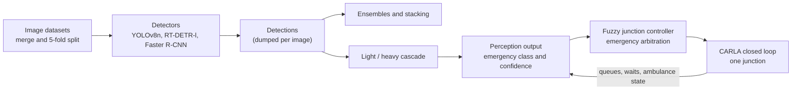
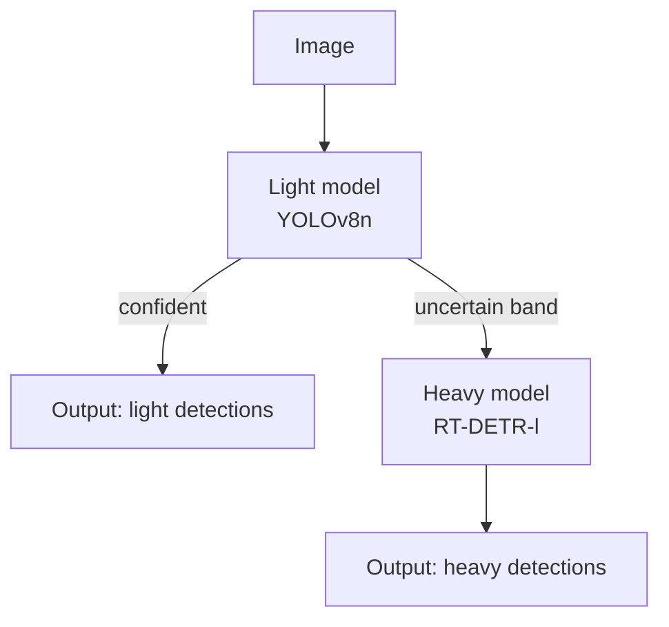
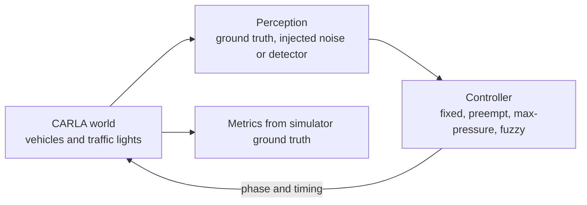
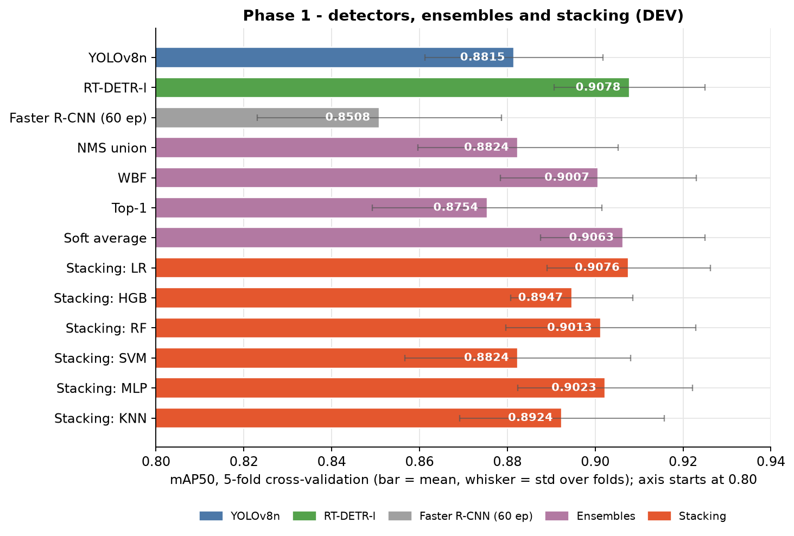
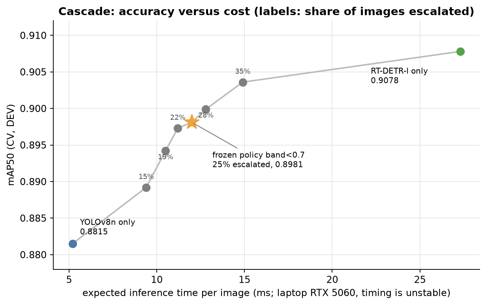
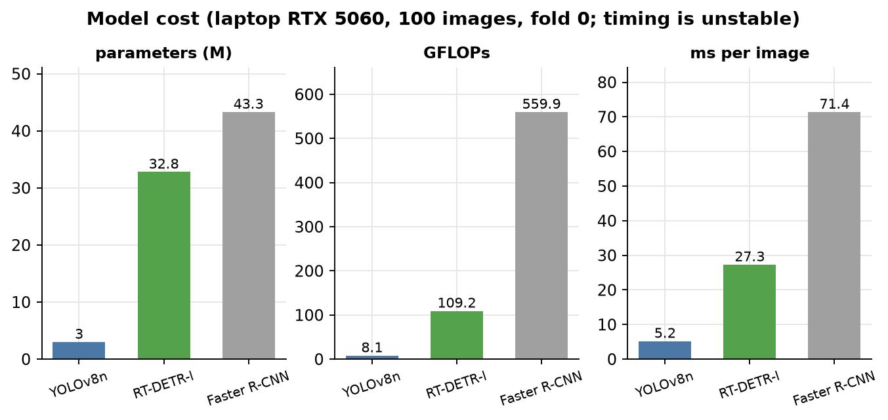
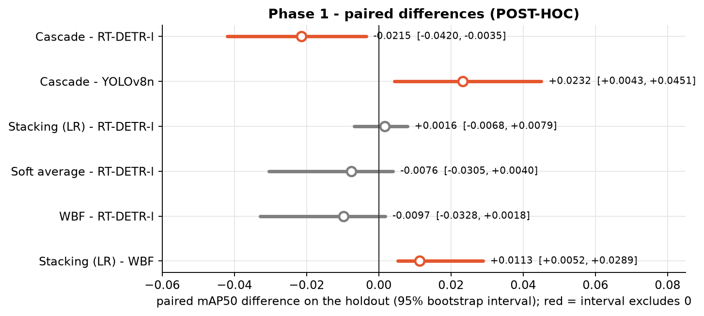
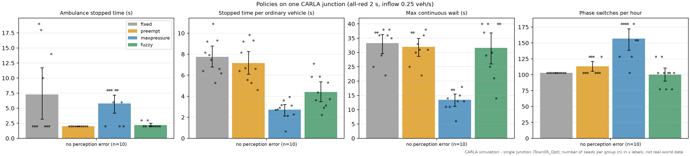
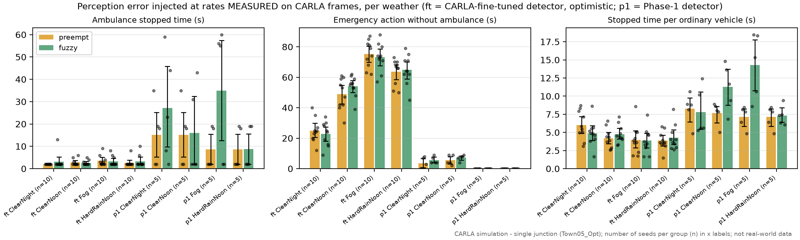
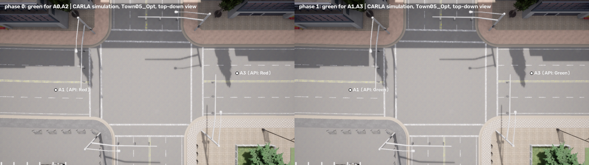

<div align="center">

# Emergency-Vehicle-Aware Traffic Signal Control

**Detection, cascade inference and closed-loop signal control with emergency-vehicle priority**


</div>

A traffic signal that gives way to an ambulance first has to *see* the ambulance. This repository follows that chain end to end:
a four-class vehicle detector with a light/heavy cascade (**Phase 1**), and a fuzzy junction controller with emergency arbitration evaluated in closed loop in the CARLA simulator, driven by ground truth, by injected perception errors and by a real detector in the loop (**Phase 2**).

| | Phase 1: perception | Phase 2: control |
|---|---|---|
| **Question** | How accurate and how costly is detection of ambulance, police, firetruck and car, and does stacking or a cascade help? | Does an emergency-aware fuzzy controller beat simple preemption, and what happens when perception is imperfect? |
| **Setting** | 5-fold cross-validation, one holdout, frozen protocol | One CARLA junction, 4 policies, 4 perception regimes |
| **Headline** | RT-DETR-l is the most accurate model (0.9208 holdout mAP50, POST-HOC); the cascade keeps most of its accuracy at 12.0 ms instead of 27.3 ms (cross-validation) | No ambulance advantage of fuzzy over simple preemption with the detector in the loop; large gap between detectors trained on real images and CARLA frames |

> [!IMPORTANT]
> **How to read the numbers.** Every number carries a label: **DEV** (used for selection, optimistic), **FROZEN-ONCE** (protocol frozen before the holdout was evaluated, evaluated once), **POST-HOC** (evaluated after the holdout was consumed), **CARLA** (simulator, one junction), **abstract queue model** (never evidence about CARLA or real traffic). Section 3.5 defines them.

## Contents

- [Chapter 3 - Method](#chapter-3---method)
- [Chapter 4 - Results](#chapter-4---results)
- [Chapter 5 - Discussion, summary and future work](#chapter-5---discussion-summary-and-future-work)
- [Repository map and reproduction](#repository-map-and-reproduction)

---

# Chapter 3 - Method

## 3.1 System overview



## 3.2 Data and splits (Phase 1)

- **Classes:** ambulance, police, firetruck, car.
- **Cross-validation:** 5 folds (`datasets/folds_v3`); every fold trains on 28,099 images and validates on 689 images. Selection of checkpoints, meta-learner, heavy model and cascade policy uses these folds only.
- **Holdout:** 381 images (boxes: ambulance 191, police 15, firetruck 221, car 259), evaluated once under a protocol frozen beforehand. Intervals are 95% group-bootstrap intervals (image groups from `datasets/folds_v3_manifest.csv`).
- Datasets are not included in this repository (size and license terms); the preparation scripts are in `datasets/`.

## 3.3 Detectors and training protocol

| Model | Epochs | Patience | Batch | Checkpoint rule |
|---|---|---|---|---|
| YOLOv8n | 60 | 15 | 16 | best validation fitness (mAP50-95) |
| RT-DETR-l | 60 | 15 | 8 | best validation fitness (mAP50-95) |
| Faster R-CNN (`fasterrcnn_resnet50_fpn_v2`), main results (`frcnn60/`) | 60 | 15 | 4 | best validation fitness (mAP50-95) |
| Faster R-CNN, first run (appendix 4.12) | 15 | none | 4 | last epoch (protocol mismatch) |

Training arguments of the first two models are stored in `results_v3/train_logs/*/args.yaml`. All methods are scored with the same code: torchmetrics mAP, confidence ≥ 0.02, top 100 detections per image.

> [!NOTE]
> **Faster R-CNN.** The first Faster R-CNN run used 15 epochs and the last checkpoint, which did not match the other two models. It was retrained under the shared protocol (60 epochs, patience 15, best checkpoint). Cross-validation mAP50 changed from 0.8424 to 0.8508 (+0.0084), so the retraining changed no conclusion; the first-run numbers are kept in appendix 4.12. Best checkpoints of all three models are selected on the validation fold that the meta-learner and the cross-validation also use; cross-validation numbers are DEV for that reason.

## 3.4 Ensembles, stacking and the cascade

- **Ensembles over detections:** NMS union, weighted box fusion (WBF), soft average, top-1.
- **Stacking:** meta-learners (LR, HGB, RF, SVM, MLP, KNN) trained on cross-validated detections. The meta-learner is chosen by a rule fixed beforehand (best CV mAP50): `LR`.
- **Cascade:** the light model (YOLOv8n) answers; images whose light-model confidence falls in an uncertainty band are sent whole to the heavy model (RT-DETR-l). The policy is the smallest escalation rate whose CV mAP50 stays within 0.01 of the heavy model alone.



Frozen protocol (2026-11-20 21:59:31): meta=LR, heavy=rtdetr_l, cascade=band<0.7 (fallback=False)

## 3.5 Evaluation protocol and result labels

| Label | Meaning |
|---|---|
| **DEV** | a choice (checkpoint, threshold, design) was made while looking at the same data; optimistic |
| **FROZEN-ONCE** | rules written to `protocol_frozen.json` before the holdout was touched; holdout evaluated once |
| **POST-HOC** | computed after the holdout had been consumed, or defined after seeing results |
| **CARLA** | measured in the CARLA simulator on one junction; never a real-world measurement |
| **abstract queue model** | output of `phase2_bridge/toy_sim.py`; figures carry the watermark "abstract queue model - not CARLA" |

The holdout is consumed (`holdout_done.flag`); any further evaluation on it is POST-HOC, and a new protocol must be frozen before looking at results.

## 3.6 Control study (Phase 2)



- **Simulator and junction:** CARLA 0.9.16, map `Town05_Opt`, junction index 14: four approaches (A0 to A3), two lanes each, two signal phases (A0+A2, A1+A3).
- **Scenario:** 160 s per run, 20 s warm-up, 1 s control step, 0.05 s simulation step, background traffic with inflow 0.25, 2 s all-red. One ambulance on approach A0, 25 to 38 m upstream of the stop line, spawned at a random time, identical across policies for the same seed.
- **Controllers:**

| Policy | Idea |
|---|---|
| `fixed` | fixed cycle (30 s green, 3 s yellow) |
| `preempt` | fixed cycle plus simple preemption when an emergency vehicle is detected (confidence ≥ 0.6, track age ≥ 1 s) |
| `maxpressure` | queue-pressure phase selection, green 10 to 60 s |
| `fuzzy` | fuzzy queue pressure plus emergency arbitration that minimises expected weighted delay; three modes (normal, degraded, static) driven by a perception-health signal |

- **Perception regimes:** (1) ground truth; (2) injected noise with swept parameters (not measured); (3) injected noise with rates measured offline; (4) **detector in the loop**: queues and distances come from the simulator, the emergency class from a detector run on the camera frame (hybrid mode; vision-only perception is not built).
- **Metrics (from simulator ground truth):** ambulance stopped time, ordinary-vehicle stopped time per vehicle, maximum wait, phase switches per hour, throughput, and false-preemption time. Ambulance time-to-cross is survivor-biased.
- **Reproducibility defect found and fixed:** the noise generator drew random numbers in the order of the simulator's actor list, which changes between runs. After sorting inputs with a stable key and auditing, noisy results reproduce exactly; earlier noisy results are discarded and not reported.

---

# Chapter 4 - Results

## 4.1 Phase 1: accuracy of detectors, ensembles and stacking (DEV)

<p align="center"></p>

RT-DETR-l reaches **0.9078** mAP50 and YOLOv8n **0.8815**; Faster R-CNN (60 epochs) reaches 0.8508 (0.8424 in the first 15-epoch run). Ensembles and stacking stay at or below RT-DETR-l.

<details>
<summary>Full cross-validation table (mean ± std over 5 folds)</summary>

| method | mAP50 | mAP50-95 | AP50 police | AP50 ambulance |
|---|---|---|---|---|
| single_yolov8n | 0.8815±0.0203 | 0.7593±0.0155 | 0.9695±0.0283 | 0.9666±0.0202 |
| single_rtdetr_l | 0.9078±0.0172 | 0.7923±0.0173 | 0.9842±0.0186 | 0.9783±0.0171 |
| single_fasterrcnn | 0.8508±0.0278 | 0.7035±0.0236 | 0.9579±0.0462 | 0.9538±0.0200 |
| nms_union | 0.8824±0.0228 | 0.7315±0.0223 | 0.9723±0.0317 | 0.9814±0.0145 |
| wbf | 0.9007±0.0223 | 0.7820±0.0197 | 0.9805±0.0262 | 0.9819±0.0140 |
| top1_ensemblenet_style | 0.8754±0.0261 | 0.7270±0.0252 | 0.9586±0.0355 | 0.9736±0.0114 |
| softavg | 0.9063±0.0187 | 0.7523±0.0195 | 0.9807±0.0265 | 0.9813±0.0146 |
| meta_LR | 0.9076±0.0186 | 0.7453±0.0166 | 0.9757±0.0296 | 0.9781±0.0165 |
| meta_HGB | 0.8947±0.0139 | 0.7359±0.0187 | 0.9390±0.0322 | 0.9775±0.0168 |
| meta_RF | 0.9013±0.0216 | 0.7446±0.0213 | 0.9768±0.0314 | 0.9781±0.0163 |
| meta_SVM | 0.8824±0.0257 | 0.7164±0.0258 | 0.9702±0.0340 | 0.9708±0.0194 |
| meta_MLP | 0.9023±0.0199 | 0.7439±0.0220 | 0.9600±0.0495 | 0.9796±0.0150 |
| meta_KNN | 0.8924±0.0233 | 0.7366±0.0244 | 0.9745±0.0355 | 0.9747±0.0212 |

</details>

## 4.2 Cascade: accuracy versus cost (DEV)

<p align="center"></p>

The frozen policy (`band<0.7`) escalates 25% of the images and reaches **0.8981** mAP50 at **12.0 ms** per image, against 5.2 ms for the light model and 27.3 ms for the heavy model alone.

<details>
<summary>Cascade policies (cross-validation)</summary>

| policy | escalation | mAP50 | expected ms/img |
|---|---|---|---|
| light_only | 0.00 | 0.8815±0.0203 | 5.2 |
| heavy_only | 1.00 | 0.9078±0.0172 | 27.3 |
| band<0.4 | 0.15 | 0.8892±0.0142 | 9.4 |
| band<0.5 | 0.19 | 0.8942±0.0165 | 10.5 |
| band<0.6 | 0.22 | 0.8973±0.0170 | 11.2 |
| band<0.7 | 0.25 | 0.8981±0.0165 | 12.0 |
| band<0.8 | 0.28 | 0.8999±0.0159 | 12.8 |
| band<0.9 | 0.35 | 0.9036±0.0189 | 14.9 |

</details>

The cascade was also tried with Faster R-CNN as the heavy model or as a second tier (DEV, cross-validation). It did not help: any cascade that sends images to Faster R-CNN is no cheaper than, and no more accurate than, the frozen `band<0.7` policy; the full report follows. This is a negative result.

<details>
<summary>Extended cascade report (DEV)</summary>

**Extended cascade (CV, DEV)**

Reference single-model mAP50 (best of RT-DETR-l, Faster R-CNN): 0.9078; target = 0.8978; selected = r|b1<0.7

| policy | esc to heavy1 | esc to heavy2 | mAP50 mean±std | expected ms/img |
|---|---|---|---|---|
| light_only | 0.00 | 0.00 | 0.8815±0.0203 | 5.2 |
| r|b1<0.4 | 0.15 | 0.00 | 0.8892±0.0142 | 9.4 |
| r|b1<0.5 | 0.19 | 0.00 | 0.8942±0.0165 | 10.5 |
| r|b1<0.6 | 0.22 | 0.00 | 0.8973±0.0170 | 11.2 |
| r|b1<0.7 | 0.25 | 0.00 | 0.8981±0.0165 | 12.0 |
| r|b1<0.8 | 0.28 | 0.00 | 0.8999±0.0159 | 12.8 |
| r|b1<0.9 | 0.35 | 0.00 | 0.9036±0.0189 | 14.9 |
| f|b1<0.4 | 0.15 | 0.00 | 0.8451±0.0179 | 16.1 |
| tier2|b1<0.4|b2<0.5 | 0.15 | 0.12 | 0.8802±0.0169 | 17.9 |
| tier2|b1<0.4|b2<0.7 | 0.15 | 0.13 | 0.8782±0.0187 | 18.8 |
| f|b1<0.5 | 0.19 | 0.00 | 0.8443±0.0189 | 19.0 |
| tier2|b1<0.4|b2<0.9 | 0.15 | 0.14 | 0.8783±0.0187 | 19.2 |
| fuse|b1<0.4 | 0.15 | 0.15 | 0.8780±0.0188 | 20.2 |
| tier2|b1<0.5|b2<0.5 | 0.19 | 0.14 | 0.8837±0.0179 | 20.6 |
| f|b1<0.6 | 0.22 | 0.00 | 0.8438±0.0217 | 20.7 |
| tier2|b1<0.5|b2<0.7 | 0.19 | 0.16 | 0.8821±0.0194 | 21.8 |
| tier2|b1<0.6|b2<0.5 | 0.22 | 0.15 | 0.8859±0.0187 | 22.2 |
| tier2|b1<0.5|b2<0.9 | 0.19 | 0.17 | 0.8824±0.0195 | 22.4 |
| f|b1<0.7 | 0.25 | 0.00 | 0.8429±0.0179 | 22.9 |
| tier2|b1<0.6|b2<0.7 | 0.22 | 0.18 | 0.8844±0.0198 | 23.8 |
| tier2|b1<0.7|b2<0.5 | 0.25 | 0.17 | 0.8881±0.0177 | 23.9 |
| fuse|b1<0.5 | 0.19 | 0.19 | 0.8821±0.0196 | 24.2 |
| tier2|b1<0.6|b2<0.9 | 0.22 | 0.19 | 0.8849±0.0201 | 24.6 |
| f|b1<0.8 | 0.28 | 0.00 | 0.8407±0.0178 | 25.0 |
| tier2|b1<0.8|b2<0.5 | 0.28 | 0.18 | 0.8894±0.0175 | 25.5 |
| tier2|b1<0.7|b2<0.7 | 0.25 | 0.19 | 0.8866±0.0185 | 25.8 |
| fuse|b1<0.6 | 0.22 | 0.22 | 0.8845±0.0201 | 26.7 |
| tier2|b1<0.7|b2<0.9 | 0.25 | 0.21 | 0.8876±0.0190 | 27.2 |
| rtdetr_only | 1.00 | 0.00 | 0.9078±0.0172 | 27.3 |
| tier2|b1<0.8|b2<0.7 | 0.28 | 0.21 | 0.8885±0.0180 | 27.6 |
| tier2|b1<0.9|b2<0.5 | 0.35 | 0.19 | 0.8929±0.0208 | 28.3 |
| tier2|b1<0.8|b2<0.9 | 0.28 | 0.23 | 0.8892±0.0184 | 29.4 |
| fuse|b1<0.7 | 0.25 | 0.25 | 0.8872±0.0188 | 29.6 |
| f|b1<0.9 | 0.35 | 0.00 | 0.8357±0.0245 | 30.5 |
| tier2|b1<0.9|b2<0.7 | 0.35 | 0.22 | 0.8918±0.0219 | 30.5 |
| fuse|b1<0.8 | 0.28 | 0.28 | 0.8886±0.0184 | 32.5 |
| tier2|b1<0.9|b2<0.9 | 0.35 | 0.25 | 0.8914±0.0244 | 32.8 |
| fuse|b1<0.9 | 0.35 | 0.35 | 0.8905±0.0249 | 40.2 |
| frcnn_only | 1.00 | 0.00 | 0.8508±0.0278 | 71.4 |
| wbf_heavy_only | 1.00 | 1.00 | 0.8974±0.0227 | 98.7 |

Paired per-fold differences versus the best single heavy model (DEV):
- wbf_heavy_only_minus_best_single_per_fold: mean -0.0104, std 0.0071, per fold [-0.0192, -0.0058, -0.0035, -0.0169, -0.0067]
- rtdetr_only_minus_best_single_per_fold: mean +0.0000, std 0.0000, per fold [0.0, 0.0, 0.0, 0.0, 0.0]
- frcnn_only_minus_best_single_per_fold: mean -0.0570, std 0.0136, per fold [-0.0742, -0.043, -0.0454, -0.0675, -0.0548]

</details>

## 4.3 Model cost

<p align="center"></p>

<details>
<summary>Cost table</summary>

| model | params (M) | GFLOPs | ms/img median | FPS |
|---|---|---|---|---|
| yolov8n | 3.0 | 8.1 | 5.2 | 191.1 |
| rtdetr_l | 32.8 | 109.2 | 27.3 | 36.7 |
| fasterrcnn | 43.3 | 559.9 | 71.4 | 14.0 |

</details>

## 4.4 Holdout (POST-HOC: consumed earlier, evaluated once under the v4 frozen protocol)

<p align="center"></p>

<p align="center"></p>

Paired differences (95% group-bootstrap intervals):

- Cascade - RT-DETR-l: **-0.0215**, 95% interval [-0.0420, -0.0035]
- Cascade - YOLOv8n: **+0.0232**, 95% interval [+0.0043, +0.0451]
- Stacking (LR) - RT-DETR-l: **+0.0016**, 95% interval [-0.0068, +0.0079]
- Soft average - RT-DETR-l: **-0.0076**, 95% interval [-0.0305, +0.0040]
- WBF - RT-DETR-l: **-0.0097**, 95% interval [-0.0328, +0.0018]
- Stacking (LR) - WBF: **+0.0113**, 95% interval [+0.0052, +0.0289]

Reading: stacking brings **no measurable gain** over RT-DETR-l (+0.0016 [-0.0068, +0.0079]); the cascade is **worse than the heavy model** (-0.0215 [-0.0420, -0.0035]) and **better than the light model** (+0.0232 [+0.0043, +0.0451]), so it is a speed/accuracy trade-off, not an accuracy gain.

<details>
<summary>Holdout table</summary>

| method | mAP50 | CI95 (group bootstrap) | AP50 police | police CI95 |
|---|---|---|---|---|
| single_yolov8n | 0.8618 | [0.828, 0.944] | 0.972 | [0.921, 1.000] |
| single_rtdetr_l | 0.9208 | [0.909, 0.964] | 0.986 | [0.960, 1.000] |
| single_fasterrcnn | 0.7709 | - | 0.976 | - |
| nms_union | 0.8830 | [0.844, 0.950] | 0.985 | [0.959, 1.000] |
| wbf | 0.9116 | [0.883, 0.957] | 0.985 | [0.957, 1.000] |
| top1_ensemblenet_style | 0.8590 | - | 0.958 | - |
| softavg | 0.9136 | [0.884, 0.960] | 0.985 | [0.957, 1.000] |
| meta_LR | 0.9211 | [0.906, 0.965] | 0.991 | [0.972, 1.000] |
| cascade_frozen | 0.8917 | [0.868, 0.960] | 0.972 | [0.921, 1.000] |

</details>

This holdout had already been consumed by the first (15-epoch) run, so these numbers carry the label POST-HOC even though the v4 protocol was frozen before this evaluation. The first run's holdout numbers (FROZEN-ONCE) are in appendix 4.12.

The image-level cascade table in `results_v3/image_cascade_holdout_final.json` (emergency-class mAP50 with risk-controlled thresholds) is **POST-HOC**: the holdout had already been used and the emergency metric was defined after seeing results; its parameters were frozen on validation data.

## 4.5 Phase 2: policies without perception error (CARLA)

<p align="center"></p>

| Policy | Ambulance stopped (s) | Stopped per ordinary vehicle (s) | Max wait (s) | Switches / h | Ordinary vehicles / min |
|---|---|---|---|---|---|
| fixed | 7.30 | 7.74 | 33.30 | 102.9 | 7.37 |
| preempt | 2.00 | 7.16 | 32.00 | 113.1 | 7.24 |
| maxpressure | 5.80 | **2.73** | **13.50** | 156.9 | 6.64 |
| fuzzy | 2.20 | 4.41 | 31.60 | 100.3 | 6.64 |

*10 seeds; means. Fuzzy minus preempt, paired by seed (95% bootstrap interval): ambulance stopped +0.20 s [+0.00, +0.50]; stopped per ordinary vehicle -2.75 s [-4.45, -1.23].*

## 4.6 Phase 2: detectors on CARLA frames (domain gap)

<p align="center"></p>

- A detector trained on real images only (`yolov8n_fold0`) finds few vehicles in CARLA frames (validation capture, conf ≥ 0.5, found rate: ambulance 0.07, police 0.16, firetruck 0.01, car 0.03).
- After fine-tuning on CARLA frames, the validation capture gives ambulance 1.00, police 0.93, firetruck 1.00, car 0.87 (checkpoint selected on it: **DEV**). On the held-out capture (new camera pose and seeds; same junction and vehicle models): ambulance 0.99, police 0.88, firetruck 0.99, car 0.75.

<p align="center"></p>

## 4.7 Phase 2: injected noise versus detector in the loop (CARLA)

<p align="center"></p>

<p align="center"></p>

- With the CARLA-fine-tuned detector in the loop the ambulance is recognised in nearly all visible frames; **fuzzy shows no advantage over preempt** for the ambulance (+0.5 to +0.6 s, lower interval bound 0.0 s). Ordinary vehicles stop about 2.0 to 2.5 s less per vehicle under fuzzy (interval excludes 0 in all four weather conditions; the four weather conditions share the same traffic scenes, so these are not four independent confirmations).
- With the detector trained on real images only, the ambulance is almost never recognised in the loop.
- False emergency action is about 23 to 75 s per run with injected measured-rate noise and about 0 to 5 s with the detector in the loop. Injected noise is a **pessimistic stress test, not a prediction**; the cause is not tested (hypothesis: injected false alarms persist 1 to 5 s by assumption).

## 4.8 Simulator renders

<p align="center"></p>

<p align="center"></p>

*Row 1: phase 0 (A0 and A2 green); row 2: phase 1 (A1 and A3 green). The mapping between lights and approaches is checked by stop-line distance (mismatch ≤ 0.01 m), by behaviour, by pixel colour counts and by eye.*

The full Phase 2 report (all tables, protocols, per-weather results) is in [`phase2_bridge/README.md`](phase2_bridge/README.md).

## 4.9 COCO benchmark of the same methods (FROZEN-ONCE on the COCO test half)

Three COCO-pretrained detectors (no training by us), classes car, motorcycle, bus, truck, 2500 test images (a dev half of equal size and seed 42 was used to calibrate; everything was frozen before the test half was read). Metric: torchmetrics mAP50, not comparable to the COCO leaderboard.

| method | mAP50 | 95% interval |
|---|---|---|
| YOLOv8n | 0.5718 | [0.532, 0.619] |
| RT-DETR-l | 0.7584 | [0.734, 0.782] |
| Faster R-CNN (COCO-pretrained) | 0.7635 | - |
| NMS union | 0.7823 | - |
| WBF | 0.7605 | [0.736, 0.788] |
| Top-1 | 0.7412 | - |
| Soft average | 0.7873 | [0.767, 0.810] |
| Stacking: LR | 0.7781 | [0.753, 0.801] |

Paired differences on the test half (95% bootstrap intervals):

- Stacking (LR) - RT-DETR-l: **+0.0203**, 95% interval [+0.0102, +0.0317]
- Soft average - RT-DETR-l: **+0.0295**, 95% interval [+0.0195, +0.0407]
- WBF - RT-DETR-l: **+0.0036**, 95% interval [-0.0117, +0.0195]
- Stacking (LR) - WBF: **+0.0167**, 95% interval [+0.0010, +0.0328]
- Cascade (band<0.7, no recalibration) - RT-DETR-l: **-0.0449**, 95% interval [-0.0624, -0.0301]

Risk-controlled cascade on COCO (threshold calibrated on the dev half):

| risk level rho | escalated | mAP50 | cascade - RT-DETR-l | share of light-to-heavy gap closed (median, 95%) | random routing, same escalation |
|---|---|---|---|---|---|
| 0.333 | 11.4% | 0.7054 | -0.0517 [-0.0684, -0.0378] | 0.72 [0.64, 0.81] | +0.02 [-0.04, +0.09] |
| 0.500 | 8.6% | 0.6935 | -0.0631 [-0.0837, -0.0451] | 0.66 [0.55, 0.77] | -0.01 [-0.07, +0.07] |
| 0.667 | 5.5% | 0.6561 | -0.0995 [-0.1226, -0.0790] | 0.46 [0.33, 0.60] | -0.01 [-0.06, +0.06] |

Reading: on COCO, soft average and stacking beat RT-DETR-l by a small amount; WBF does not. The cascade closes much more than random routing of the light-to-heavy gap but stays below the heavy model. Comparisons added after the frozen evaluation (`results_coco/coco_extra.json`) are POST-HOC.

## 4.10 Leakage audit of the holdout (POST-HOC)

Perceptual-hash audit (difference hash, distance ≤ 4 of 64 bits, mirrored copies included) of the holdout images against the training folds:

| A (holdout) | B (training folds) | near-duplicates of A found in B |
|---|---|---|
| `holdout_v3` | `folds_v3/fold_0` (28788 images) | 0 of 381 |
| `holdout_v3` | `folds_v3/fold_4` (28779 images) | 0 of 381 |
| `holdout_v4` | `folds_v3/fold_0` (28788 images) | 0 of 381 |

Zero near-duplicates were found. The method does not detect different frames of the same video or scene, so zero is not proof of independence. Exact (md5) overlap of `holdout_v3` with `folds_v3` is also 0 of 381. The earlier holdout (`holdout_eval`, 1036 images) overlapped 95.5% with the training folds and is not used.

## 4.11 Abstract queue model and two-hop messaging (abstract queue model)

`phase2_bridge/toy_sim.py` is a simplified queue model of a corridor. **Nothing in this section is evidence about CARLA or real traffic.** The full tables (20 seeds, paired by seed, plus a 3-junction run with 10 seeds) are generated from the CSV files in [`phase2_bridge/ABSTRACT_MODEL.md`](phase2_bridge/ABSTRACT_MODEL.md).

- With messages to one junction each way, the fuzzy controller lowers the emergency delay against simple preemption and against no communication at the base demand, at a small cost for ordinary traffic and at a measured cost in false-preemption time.
- Extending the messages to two junctions each way does **not** help at the base demand (ordinary delay is higher in every seed, emergency delay is unchanged within the interval) and gains nothing under the tested message delays or losses either.
- In saturated demand (spillbacks present), the two-hop emergency notices reduce emergency delay and spillbacks; the two-hop pressure term alone has no measurable effect. The hop-2 weight made no difference at the base demand.
- Messaging to two junctions each way exists only in this model; it was not run in CARLA.

## 4.12 Appendix: first run with the 15-epoch Faster R-CNN

Frozen protocol of the first run: Frozen protocol (2026-10-28 14:33:48): meta=LR, heavy=rtdetr_l, cascade=band<0.7 (fallback=False). The Faster R-CNN here used 15 epochs and the last checkpoint, which did not match the other models; ensemble, stacking and cascade rows that use it as an input are affected.

<details>
<summary>Cross-validation, 15-epoch Faster R-CNN (DEV)</summary>

| method | mAP50 | mAP50-95 | AP50 police | AP50 ambulance |
|---|---|---|---|---|
| single_yolov8n | 0.8815±0.0203 | 0.7593±0.0155 | 0.9695±0.0283 | 0.9666±0.0202 |
| single_rtdetr_l | 0.9078±0.0172 | 0.7923±0.0173 | 0.9842±0.0186 | 0.9783±0.0171 |
| single_fasterrcnn | 0.8424±0.0333 | 0.6977±0.0284 | 0.9585±0.0381 | 0.9502±0.0193 |
| nms_union | 0.8773±0.0307 | 0.7229±0.0252 | 0.9705±0.0257 | 0.9798±0.0154 |
| wbf | 0.8988±0.0250 | 0.7821±0.0216 | 0.9793±0.0227 | 0.9802±0.0159 |
| top1_ensemblenet_style | 0.8716±0.0296 | 0.7210±0.0247 | 0.9555±0.0240 | 0.9719±0.0156 |
| softavg | 0.9031±0.0224 | 0.7467±0.0175 | 0.9793±0.0227 | 0.9799±0.0157 |
| meta_LR | 0.9064±0.0221 | 0.7406±0.0194 | 0.9694±0.0293 | 0.9778±0.0168 |
| meta_HGB | 0.8933±0.0246 | 0.7283±0.0242 | 0.9327±0.0465 | 0.9772±0.0166 |
| meta_RF | 0.9002±0.0243 | 0.7423±0.0212 | 0.9699±0.0276 | 0.9784±0.0159 |
| meta_SVM | 0.8784±0.0351 | 0.7093±0.0260 | 0.9504±0.0520 | 0.9696±0.0200 |
| meta_MLP | 0.9029±0.0171 | 0.7423±0.0149 | 0.9627±0.0193 | 0.9784±0.0159 |
| meta_KNN | 0.8900±0.0240 | 0.7308±0.0192 | 0.9710±0.0268 | 0.9696±0.0161 |

</details>

<details>
<summary>Holdout (evaluated once; 381 images, boxes {'ambulance': 191, 'police': 15, 'firetruck': 221, 'car': 259}); mean over 5 fold-models (FROZEN-ONCE)</summary>

| method | mAP50 | CI95 (group bootstrap) | AP50 police | police CI95 |
|---|---|---|---|---|
| single_yolov8n | 0.8618 | [0.828, 0.944] | 0.972 | [0.921, 1.000] |
| single_rtdetr_l | 0.9208 | [0.909, 0.964] | 0.986 | [0.960, 1.000] |
| single_fasterrcnn | 0.7921 | - | 0.984 | - |
| nms_union | 0.8931 | [0.858, 0.955] | 0.984 | [0.956, 1.000] |
| wbf | 0.9140 | [0.887, 0.959] | 0.985 | [0.957, 1.000] |
| top1_ensemblenet_style | 0.8694 | - | 0.958 | - |
| softavg | 0.9159 | [0.889, 0.961] | 0.985 | [0.957, 1.000] |
| meta_LR | 0.9200 | [0.906, 0.963] | 0.986 | [0.960, 1.000] |
| cascade_frozen | 0.8917 | [0.868, 0.960] | 0.972 | [0.921, 1.000] |

Paired differences:

- Cascade - RT-DETR-l: **-0.0215**, 95% interval [-0.0420, -0.0035]
- Cascade - YOLOv8n: **+0.0232**, 95% interval [+0.0043, +0.0451]
- Stacking (LR) - RT-DETR-l: **+0.0004**, 95% interval [-0.0055, +0.0059]
- Soft average - RT-DETR-l: **-0.0055**, 95% interval [-0.0242, +0.0041]
- WBF - RT-DETR-l: **-0.0073**, 95% interval [-0.0277, +0.0029]
- Stacking (LR) - WBF: **+0.0077**, 95% interval [+0.0019, +0.0244]

</details>

---

# Chapter 5 - Discussion, summary and future work

## 5.1 Phase 1

- **The cascade is a cost lever, not an accuracy lever.** It recovers most of the gap between the light and heavy model at roughly half of the heavy model's cost in cross-validation, but on the holdout it stays below the heavy model alone.
- **Stacking adds nothing measurable** on the emergency data: the paired difference to RT-DETR-l is +0.0016 [-0.0068, +0.0079] on the holdout.
- **Retraining Faster R-CNN changed nothing important.** Under the shared protocol its cross-validation mAP50 moved by +0.0084 (0.8424 to 0.8508); it stays the weakest of the three models and no ensemble, stacking or cascade variant that uses it beats RT-DETR-l alone.
- **On COCO the picture differs a little.** Soft average and stacking beat RT-DETR-l by a small amount there, while on the emergency data they do not (section 4.9 versus 4.4).

## 5.2 Phase 2

- **Priority.** Simple preemption already reaches the floor of about 2 s of ambulance stopped time; the fuzzy controller matches it but does not beat it, with or without perception error.
- **Ordinary traffic.** Max-pressure is clearly best for ordinary traffic in the clean regime; fuzzy improves on preempt (-2.75 s per vehicle) but not on max-pressure.
- **Perception matters more than the controller.** The detector trained on real images fails on CARLA frames, and fine-tuning closes the gap only within the same junction and vehicle models.
- **Method.** An ordering defect in the noise generator made noisy runs irreproducible; finding and fixing it changed which results can be reported.

## 5.3 Threats to validity

- One junction on one map; the held-out CARLA capture uses the same junction and the same vehicle models, so it is not a new environment.
- Weather conditions share the same traffic scene for equal seeds; they are not independent repetitions. Weather-visibility proxy is uncalibrated.
- The fine-tuned detector's validation-set numbers are DEV and optimistic.
- Injected-noise experiments are stress tests; their parameters are not measurements of a real system.
- Car labels in the validation and holdout data are incomplete, so car AP is not a clean metric. `holdout_v3` and `holdout_v4` contain the same 381 image names and 49 label files differ.
- The holdout is consumed, so its numbers are POST-HOC for the second run. The near-duplicate audit (section 4.10) found no overlap but cannot see different frames of one scene. Police has very few holdout boxes, so any police number needs its interval.
- GPU timing on the laptop is unstable; use it for ordering, not for precise ratios.
- No real-world data: the simulation-to-reality gap is not measured here.

## 5.4 Summary

A heavy detector (RT-DETR-l) is the most accurate model; a light/heavy cascade trades a small accuracy loss for about half of the cost; stacking brings no gain. In closed loop in CARLA, a fuzzy emergency-aware controller matches simple preemption for the ambulance and does not exceed it, perception quality in simulation is dominated by the domain gap, and injected noise gives pessimistic but unvalidated stress tests.

## 5.5 Future work

1. Freeze a new protocol before any further holdout evaluation; a new, untouched holdout would restore a FROZEN-ONCE evaluation.
2. Extend the CARLA study to several junctions with two-hop message passing (implemented and run only in the abstract queue model so far).
3. Build vision-only perception (queues and distances from images) and calibrate the weather-visibility proxy.
4. Validate on real footage and a second map before making any claim about real traffic.

---

# Repository map and reproduction

| Path | Content |
|---|---|
| `datasets/` | dataset preparation, fold generation and training scripts (no data) |
| `results_v4_frcnn60/` | main run: frozen protocol, final report, cross-validation JSON, extended cascade report, holdout results (no detection dumps) |
| `results_v3/` | first run (15-epoch Faster R-CNN): frozen protocol, final report, holdout results, training logs |
| `results_coco/` | COCO benchmark results and frozen protocol |
| `stacking/` and `stacking_v4/` | ensembles, stacking, cascade, audits and benchmark scripts (first run and retrained run) |
| `docs/leakage_audit/` | near-duplicate audit scripts and logs |
| `figures_pipeline/` | figure scripts and `build_root_readme.py`, which regenerates this README |
| `docs/readme_figures/` | figures in this README (generated from `results_v4_frcnn60/final_report.md`) |
| `phase2_bridge/` | controllers, CARLA bridge, abstract queue model, tests, Phase 2 results and report |
| `frcnn60/` | Faster R-CNN 60-epoch retraining scripts |
| `requirements_frozen.txt` | frozen package versions |

Datasets and model weights are not committed.

```bash
pip install -r requirements_frozen.txt
python figures_pipeline/build_root_readme.py   # rebuilds the figures and this README from the result files
```

Phase 2 reproduction (CARLA 0.9.16, one run per process, seeds and gates) is described in [`phase2_bridge/README.md`](phase2_bridge/README.md).
