<div align="center">

# Emergency-Vehicle-Aware Traffic Signal Control

**Detection, cascade inference and closed-loop signal control with emergency-vehicle priority**


</div>

A traffic signal that gives way to an ambulance first has to *see* the ambulance. This repository follows that chain end to end:
a four-class vehicle detector with a light/heavy cascade (**Phase 1**), and a fuzzy junction controller with emergency arbitration evaluated in closed loop in the CARLA simulator, driven by ground truth, by injected perception errors and by a real detector in the loop (**Phase 2**).

| | Phase 1: perception | Phase 2: control |
|---|---|---|
| **Question** | How accurate and how costly is detection of ambulance, police, firetruck and car, and does stacking or a cascade help? | Does an emergency-aware fuzzy controller beat simple preemption, and what happens when perception is imperfect? |
| **Setting** | 5-fold cross-validation, one holdout, frozen protocol | One CARLA junction, 4 policies, 4 perception regimes |
| **Headline** | RT-DETR-l is the most accurate model (0.9208 holdout mAP50, POST-HOC); the cascade keeps most of its accuracy at 12.0 ms instead of 27.3 ms (cross-validation) | No ambulance advantage of fuzzy over simple preemption with the detector in the loop; large gap between detectors trained on real images and CARLA frames |

> [!IMPORTANT]
> **How to read the numbers.** Every number carries a label: **DEV** (used for selection, optimistic), **FROZEN-ONCE** (protocol frozen before the holdout was evaluated, evaluated once), **POST-HOC** (evaluated after the holdout was consumed), **CARLA** (simulator, one junction), **abstract queue model** (never evidence about CARLA or real traffic). Section 3.6 defines them.

## Abstract

A traffic signal can only give way to an emergency vehicle that it has noticed. This report follows that chain from the camera image to the signal phase. **Part I (perception)** compares three detectors (YOLOv8n, RT-DETR-l, Faster R-CNN) on four vehicle classes (ambulance, police car, fire truck, car) with 5-fold cross-validation and one holdout, tests ensembling and stacking against the best single detector, and studies a light/heavy cascade that sends only uncertain images to the heavy detector. **Part II (control)** compares a fixed-time controller, simple preemption, max-pressure control and a fuzzy controller with emergency arbitration in closed loop in the CARLA simulator, with ground-truth perception, injected perception errors and a real detector in the loop; a separate abstract queue model is used to study message passing between neighbouring junctions.

The main findings are: (i) RT-DETR-l is the most accurate detector (cross-validation mAP50 0.9078; holdout 0.9208, POST-HOC). (ii) Ensembling and stacking give no measurable gain on the emergency-vehicle data (stacking minus RT-DETR-l on the holdout: +0.0016, interval [-0.0068, +0.0079]); on a COCO benchmark soft averaging and stacking exceed the best single detector by small margins. (iii) The cascade is a speed/accuracy trade-off, not an accuracy gain: in cross-validation it keeps 0.8981 mAP50 at 12.0 ms per image instead of 0.9078 at 27.3 ms, and on the holdout it is below the heavy model (-0.0215). (iv) In closed loop in CARLA, simple preemption already reaches the floor of about 2 s of ambulance stopped time; the fuzzy controller matches but does not beat it for the ambulance and reduces ordinary-vehicle stopping time; with the detector in the loop no ambulance advantage of the fuzzy controller was found. (v) A detector trained only on real images almost never finds vehicles in CARLA frames, and fine-tuning closes the gap only within the same junction and vehicle models. (vi) In the abstract queue model, extending messages from one to two junctions each way does not help at the base demand and helps the emergency delay only under saturated demand.

Every number carries an evidence label (DEV, FROZEN-ONCE, POST-HOC, CARLA, abstract queue model; Section 3.6), negative and neutral results are reported as they are, and a perceptual-hash audit of the holdout is included together with its limits.

**Keywords:** emergency vehicle detection, traffic signal control, signal preemption, model ensembling, stacking, cascade inference, CARLA, evaluation protocol, data leakage.

---

## Contents

1. [Introduction](#1-introduction)
2. [Background and related work](#2-background-and-related-work)
3. [Method](#3-method)
4. [Results](#4-results)
5. [Discussion](#5-discussion)
6. [Conclusion and future work](#6-conclusion-and-future-work)
7. [References](#references)
8. [Appendices](#appendices)


# 1. Introduction

## 1.1 Motivation

Traffic signals control the flow of urban traffic at junctions. Emergency vehicles (ambulances, fire trucks, police cars) behave differently from other traffic: arrival time matters, and waiting at a red signal or in a junction queue costs part of it. Signal preemption temporarily changes the signal plan to clear the path of an emergency vehicle [1, 2]. Preemption is not free. It can lengthen queues and delays for ordinary traffic at the same junction and at neighbouring junctions. In a case study of closely spaced junctions on an arterial, a single preemption request had little effect on the corridor, whereas several requests in quick succession had a stronger effect, with arterial travel time rising by about 20 to 30 s in the worst case [1]. Later work stresses queue spillback and the negative impact on non-priority traffic [2].

Every preemption starts with awareness that an emergency vehicle is present. Image-based detection of emergency vehicles with deep learning has received attention, with datasets and models for ambulances, fire trucks and police cars [3, 4, 5]. Detection and signal control are, however, usually evaluated separately, and it is rarely asked how a perception error (a missed emergency vehicle, or a false alarm) changes the quality of signal control and the delay of ordinary traffic.

## 1.2 Problem statement

The problem has three connected layers.

**Perception.** From a camera image the system must decide whether an emergency vehicle is approaching and of which type. There are two error types: missing the vehicle (preemption is late or never happens) and a false alarm (an unnecessary preemption disturbs ordinary traffic). Accurate models are usually slower and more expensive, so accuracy has to be traded against computation.

**Decision.** At each moment the controller chooses which approach receives green. The decision must account for the emergency vehicle and for the delay of ordinary vehicles, and it must remain acceptable when perception is imperfect.

**Evaluation.** Results of both layers have to be reported with a method that can be trusted. Data leakage between training and test data, repeated use of one test set, and non-reproducible simulation runs can make results too optimistic. Leakage is a documented cause of failed reproducibility in machine-learning-based research [6].

## 1.3 Objectives and research questions

The objective is an honest evaluation of the chain from emergency-vehicle detection to signal control with priority. The questions are:

1. **RQ1.** Which detector gives the best trade-off between accuracy and cost on four vehicle classes?
2. **RQ2.** Does combining detectors (ensembling, stacking) improve on the best single detector by a measurable amount?
3. **RQ3.** Can a cascade keep most of the accuracy of the heavy detector at lower expected cost?
4. **RQ4.** Does a fuzzy emergency-aware controller beat fixed-time control, simple preemption and max-pressure, for the emergency vehicle and for ordinary traffic?
5. **RQ5.** How does perception error change the control results, and how large is the gap between a detector trained on real images and CARLA frames?
6. **RQ6.** Do the findings on RQ2 and RQ3 depend on the emergency-vehicle data, or do they appear on a public benchmark (COCO) as well?

## 1.4 Contributions

- A frozen evaluation protocol for the perception part with explicit result labels, and a perceptual-hash leakage audit of the holdout reported together with its limits.
- A cascade evaluated as a speed/accuracy trade-off with an explicit selection rule, including a negative result for cascades that use Faster R-CNN.
- An external check of ensembling, stacking and the cascade on COCO with three pre-trained detectors.
- A closed-loop CARLA study that compares ground-truth perception, injected perception error and a detector in the loop, and documents the domain gap between real and simulated images.
- Identification and repair of a reproducibility defect in the generation of injected perception noise (dependence on the order of the simulator's actor list); results from before the repair are discarded.
- A message-passing study in an abstract queue model, with an explicit statement that it was not run in CARLA.
- Code, result files and figure generators for all of the above in this repository.

## 1.5 Scope and limitations

The control study covers one junction on one simulator map. Results must not be generalised to other junctions or to real traffic. The held-out CARLA capture uses the same junction and the same vehicle models and is therefore not a new environment. Messaging up to two junctions before and after is implemented and evaluated only in the abstract queue model, not in CARLA. No real traffic data were used, and the simulation-to-reality gap is not measured. Reinforcement learning is not used; the comparison policies are rule-based and stabilising controllers.

## 1.6 Organisation

Chapter 2 reviews the background. Chapter 3 describes the data, models, protocols and simulation set-ups. Chapter 4 reports results. Chapter 5 interprets them and lists threats to validity. Chapter 6 concludes. Appendices give the first (15-epoch) Faster R-CNN run, the extended cascade study, a repository map and reproduction commands.

---

# 2. Background and related work

## 2.1 Traffic signal control

Traffic signal control aims to reduce vehicle travel time by coordinating movements at junctions. A survey notes that deployed systems still rely largely on simplified information and rule-based methods, although richer data and more computing power make more intelligent methods possible [7].

**Max-pressure.** Max-pressure control is a family of decentralised controllers for networks of signalised junctions. Varaiya [8] introduced it: the phase at each junction is chosen as a function of network queues, and the controller is stabilising if the queues stay bounded. Kouvelas et al. [9] extended it to arterial networks and showed that the decentralised controller does not need the current or future mean demand, although it needs the mean turn ratios. Its simplicity and scalability make it a strong comparison policy for ordinary traffic, which is how it is used here.

**Fuzzy control.** Fuzzy logic has been applied to signal control since the 1970s. Pappis and Mamdani [10] built a fuzzy controller for a junction of two one-way streets that turns linguistic rules into control decisions and reported lower mean vehicle delay than a vehicle-actuated controller. Chou and Teng [11] proposed another fuzzy controller and studied low, medium and heavy traffic for single and multiple junctions. Fuzzy rules express decision logic in terms close to engineering intuition and combine several criteria such as queue length and waiting time; the price is that rules and membership functions are designed by hand.

**Reinforcement learning.** Reinforcement learning is widely studied for signal control, because existing plans do not provide supervised labels that separate good from bad plans [7]. It is not used in this report.

| Approach | Main idea | Note | Source |
|---|---|---|---|
| Rule-based / fixed plan | predefined plans, simplified information | still common in deployed systems | [7] |
| Max-pressure | phase choice from queues, decentralised | queue stability; needs mean turn ratios | [8, 9] |
| Fuzzy | linguistic rules turned into fuzzy sets | better than vehicle-actuated control in an early single-junction test | [10, 11] |
| Reinforcement learning | learn from the outcome of actions | no supervised labels for good plans | [7] |

## 2.2 Signal preemption for emergency vehicles

Emergency vehicle preemption (EVP) reduces the stopped time of the emergency vehicle at a junction and improves safety [1, 2]. Nelson and Bullock [1] studied preemption on closely spaced junctions along an arterial; one request had a small effect, repeated requests a stronger one. Chen et al. [2] described a preemption system that takes queue spillback along the route and the negative impact on non-priority traffic into account, with algorithms for restoring the traffic state and a soft return to the normal plan, and reported a clear improvement of emergency travel time with lower impact on non-priority traffic.

Two points matter here. Preemption is a trade-off: the benefit to the emergency vehicle is paid for by ordinary traffic. And such evaluations usually assume that the presence of the emergency vehicle is announced correctly and on time. What happens when the announcement comes from an image detector that makes mistakes is the subject of this report.

## 2.3 Emergency-vehicle detection

Akdag et al. [3] built a large dataset of critical vehicles (fire truck, police car, ambulance, military police car, hazardous-materials truck, standard vehicle) and compared a vision transformer with traditional convolutional networks for classification; they stress the rarity of emergency vehicles and the different livery across countries, and report an average precision and recall of about 99.39% and 99.34% for the transformer-based model. Maleki et al. [4] introduced a dataset with classes such as ambulance and fire truck for vehicle detection with YOLO. Ibrahim et al. [5] combined YOLOv8 with an LSTM on audio and video input and report 96.6% accuracy for detection and classification.

These studies evaluate the detector or classifier itself. The effect of its errors on a signal controller in closed loop is not reported in the sources reviewed here.

## 2.4 Object detectors

**Two-stage: Faster R-CNN.** Ren et al. [12] introduced the region proposal network, which shares convolutional features with the detection network and makes region proposals almost free; this architecture underlies several winning entries of ILSVRC and COCO 2015.

**One-stage: YOLO.** Redmon et al. [13] cast detection as regression to spatially separated boxes and class probabilities, predicted by one network from the full image; the base model ran at 45 frames per second on a GPU. Later members of the family, including YOLOv8 in the Ultralytics library [14], are used here through the light model YOLOv8n.

**Transformer-based: RT-DETR.** Zhao et al. [15] observed that the speed and accuracy of YOLO detectors suffer from non-maximum suppression (NMS) and presented the real-time end-to-end detector RT-DETR, which does not need NMS; its RT-DETR-R50 variant reaches 53.1% AP on COCO at 108 frames per second on a T4 GPU. Here the RT-DETR-l variant is used.

The general trade-off between these families, accuracy against cost, is measured in Part I as parameters, floating-point operations and latency on a laptop GPU.

## 2.5 Combining models and cascades

**Combining detections.** NMS and its soft variants only select boxes and cannot produce an averaged localisation from several models [16]. Solovyev et al. [16] proposed weighted boxes fusion (WBF), which uses the confidence of all proposed boxes to build averaged boxes, and applied it to Open Images and COCO.

**Stacking.** Wolpert [17] introduced stacked generalisation, in which the outputs of several generalisers are combined by a higher-level model that learns their biases from held-out data (in the cross-validation fashion). He describes it as a more sophisticated version of cross-validation that combines the models instead of letting the winner take all [17].

**Cascades.** The cascade idea has a long history in computer vision: Viola and Jones [18] detect objects with a chain of increasingly complex classifiers that discard background regions early and spend more computation on promising regions. The cascade used here differs in that the decision is made per image between two deep detectors.

## 2.6 Simulation and evaluation methodology

**CARLA.** CARLA is an open-source simulator for urban driving research, built for developing, training and validating driving systems, with flexible specification of sensors and environmental conditions [19]. It allows camera images of a junction in several weather conditions and closed-loop signal control. Simulation has its own limits: the appearance of images and the behaviour of vehicles differ from the real world, and this gap is not measured here.

**Cross-validation and bootstrap.** Cross-validation and the bootstrap are two common ways to estimate accuracy and select models; Kohavi [20] compares them experimentally. The bootstrap was introduced by Efron [21]: resampling with replacement from the observed data to estimate the sampling distribution of a statistic. Here 5-fold cross-validation is used for selection (hence the label DEV), and bootstrap resampling at the level of image groups gives confidence intervals on the holdout. Group-level resampling is an adaptation of the basic method [21], not a new method.

**External benchmark.** COCO [22] contains images of everyday scenes with 91 object types, 2.5 million labelled instances in 328 thousand images. It is used here only for a supplementary check with three detectors pre-trained on COCO (no training by us) on several vehicle classes, to see whether the comparison of ensembling and cascade depends on emergency-vehicle data. It makes no claim about emergency vehicles and cannot be compared with the COCO leaderboard.

**Leakage and reproducibility.** Data leakage, where information from the test set enters training or model selection, produces over-optimistic results. Kapoor and Narayanan [6] surveyed previous research and found leakage affecting at least 294 papers in 17 scientific fields, and proposed a taxonomy of leakage types and model information sheets to prevent it. This motivates the frozen protocol, the separation of the test set, the labelling of results and the leakage audit in this report.

## 2.7 Gap addressed

For each link in the chain "see, decide, act" there are suitable methods: stabilising and fuzzy controllers [8, 9, 10, 11], preemption that accounts for the effect on ordinary traffic [1, 2], and detectors and datasets for emergency vehicles [3, 4, 5]. This report addresses (a) joint evaluation of detection and control in closed loop, including the effect of perception error; (b) an honest comparison of control policies under error-free, injected and real-detector perception, with negative and neutral results; and (c) strict use of a frozen protocol and leakage audit for the detectors [6], with the cost/accuracy trade-off of cascade and model combination [16].

---

# 3. Method

## 3.1 System overview

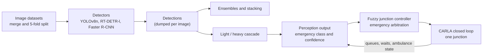

## 3.2 Data and splits (Part I)

**Classes:** ambulance, police, fire truck, car. The dataset is merged from several image sources by `datasets/merge_emergency.py` (source folders are listed below) and split by `datasets/make_folds_v3.py`: images are grouped by perceptual-hash similarity (connected components), the groups are assigned to five folds with a stratified group k-fold (seed 42), a holdout is cut out, and three car-only sources (`kitti_yolo`, `miotcd_yolo`, `visdrone_yolo`) are used for training only (script constants `TRAIN_ONLY`, `SEED`, `T_PURGE`). Datasets are not included in this repository (size and licence terms); the preparation scripts are in `datasets/`.

The fold manifest (`datasets/folds_v3_manifest.csv`) lists 13,161 grouped images. Counts below are read from the file.

| Set | Images in manifest |
|---|---|
| fold0 | 689 |
| fold1 | 691 |
| fold2 | 690 |
| fold3 | 689 |
| fold4 | 689 |
| holdout | 381 |
| train_only | 9,332 |

| Source folder | Images in manifest |
|---|---|
| `kitti_yolo` | 6,684 |
| `miotcd_yolo` | 2,500 |
| `ev_bahrain_v6` | 1,675 |
| `ev_yolo_v1` | 798 |
| `uadetrac_yolo` | 722 |
| `emergency_vehicles_raw` | 493 |
| `visdrone_yolo` | 148 |
| `ev_police_v1` | 141 |

| Class label of the image group (rarity) | Images in manifest |
|---|---|
| ambulance | 1,680 |
| police | 143 |
| firetruck | 1,284 |
| car | 10,054 |

According to the audit log, each fold directory contains 28,788 images (28,099 training and 689 validation images per fold). The relation between this count and the 13,161 manifest rows (the manifest lists grouped images; other images are not listed in it) is not documented in the files of this repository, and it is not interpreted here.

**Holdout:** 381 images (boxes: ambulance 191, police 15, firetruck 221, car 259). Intervals are 95% group-bootstrap intervals (100 resamples) over image groups from the manifest. Car labels in validation and holdout data are incomplete, so car AP is not a clean metric; police has very few holdout boxes, so any police number needs its interval.

## 3.3 Detectors and training protocol

| Model | Epochs | Patience | Batch | Checkpoint rule |
|---|---|---|---|---|
| YOLOv8n | 60 | 15 | 16 | best validation fitness (mAP50-95) |
| RT-DETR-l | 60 | 15 | 8 | best validation fitness (mAP50-95) |
| Faster R-CNN (`fasterrcnn_resnet50_fpn_v2`), main results (`frcnn60/`) | 60 | 15 | 4 | best validation fitness (mAP50-95) |
| Faster R-CNN, first run (appendix 4.12) | 15 | none | 4 | last epoch (protocol mismatch) |

Faster R-CNN (`fasterrcnn_resnet50_fpn_v2`) is trained with SGD (learning rate 0.005, momentum 0.9, weight decay 0.0005, step schedule), mixed precision and batch 4; training arguments of YOLOv8n and RT-DETR-l are stored in `results_v3/train_logs/*/args.yaml`. All methods are scored with the same code: torchmetrics mAP, confidence ≥ 0.02, top 100 detections per image. Software versions are recorded in the frozen protocol (torch 2.11.0+cu128, ultralytics 8.4.150).

> [!NOTE]
> **Faster R-CNN was trained twice.** The first run used 15 epochs and the last checkpoint, which did not match the other two models. It was retrained under the shared protocol (60 epochs, patience 15, best checkpoint by mAP50-95). Cross-validation mAP50 changed from 0.8424 to 0.8508 (+0.0084), so the retraining changed no conclusion; first-run numbers are kept in Appendix A. The best checkpoint of every model is selected on the validation fold that the meta-learner and cross-validation also use; cross-validation numbers are therefore DEV.

## 3.4 Ensembles and stacking

- **Ensembles over detections:** NMS union, weighted boxes fusion (WBF) [16], soft average, top-1.
- **Stacking** [17]: meta-learners (LR, HGB, RF, SVM, MLP, KNN) trained on cross-validated detections (leave-one-fold-out meta). The meta-learner is chosen by a rule fixed beforehand (highest CV mAP50): `LR`.
- Two-model ablations (`stack_cv_2model_*.json`) are DEV.

## 3.5 The light/heavy cascade

The light model (YOLOv8n) answers; images whose light-model confidence falls in an uncertainty band are sent whole to the heavy model (RT-DETR-l). The policy is the smallest escalation rate whose CV mAP50 stays within 0.01 of the best single heavy model. The expected cost per image uses the median latency of Section 3.7.

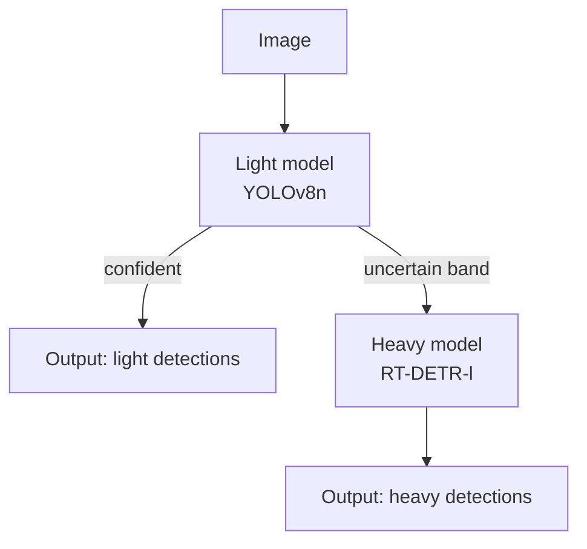

**Frozen protocol** (2026-11-20 21:59:31): meta = LR, heavy = rtdetr_l, cascade = band<0.7 (fallback = False). Rules written in the file before the holdout was evaluated:

- meta = highest CV mean mAP50 among all meta-learners run in CV
- heavy = higher CV mean single mAP50 of {rtdetr_l,fasterrcnn}
- policy = band<x with lowest mean esc_rate whose CV mAP50 >= heavy_only - 0.01; else fallback band<0.9
- holdout evaluated once; image-level escalation to full-image heavy model

The extended study (Appendix B) also tries Faster R-CNN as the heavy model or as a second tier. It is DEV only, never touches the holdout, and its selection rule is fixed in `protocol_frozen_ext.json`.

## 3.6 Evaluation protocol and result labels

| Label | Meaning |
|---|---|
| **DEV** | a choice (checkpoint, threshold, design) was made while looking at the same data; optimistic |
| **FROZEN-ONCE** | rules written to a protocol file before the holdout was touched; holdout evaluated once |
| **POST-HOC** | computed after the holdout had been consumed, or defined after seeing results |
| **CARLA** | measured in the CARLA simulator on one junction; never a real-world measurement |
| **Abstract queue model** | output of `phase2_bridge/toy_sim.py`; figures carry the watermark "abstract queue model - not CARLA" |

The holdout was consumed by the first (15-epoch Faster R-CNN) run (`results_v3/holdout_final.json`, FROZEN-ONCE) and then evaluated a second time under the protocol of the retrained run; the second evaluation is POST-HOC (`results_v4_frcnn60/holdout_done.flag`: 2026-11-20 23:03:35). Any further evaluation on it is POST-HOC, and a new protocol must be frozen before looking at results. Hashes of the scripts used are stored in the protocol files.

## 3.7 Cost measurement

Parameters, floating-point operations (counted with `torch` FlopCounterMode, 1 MAC = 2 FLOPs) and end-to-end latency (batch 1, including pre-processing and NMS, excluding disk read) are measured on NVIDIA GeForce RTX 5060 Laptop GPU for 100 images of fold 0. Laptop GPU timing is unstable; it is used for ordering, not for precise ratios.

## 3.8 External check on COCO

Three COCO-pre-trained detectors (no training by us) are evaluated on the vehicle classes car, motorcycle, bus and truck. A development half and a test half of 2,500 images each are drawn with seed 42; everything is frozen on the development half before the test half is read (FROZEN-ONCE). Metric: torchmetrics mAP, not comparable with the COCO leaderboard [22]. Cascade thresholds are calibrated on the development half with an exact (Clopper-Pearson) bound on the risk of losing a heavy-model detection (fixed-sequence procedure; τ = 0.45, δ = 0.1); the risk levels are ρ = 1/3, 1/2, 2/3. Comparisons added after the frozen evaluation (`coco_extra.json`, written later) are POST-HOC.

## 3.9 Leakage audit of the holdout

A perceptual-hash audit (64-bit difference hash, Hamming distance ≤ 4, mirrored copies included) compares the holdout images with the training folds (`stacking/audit_cross.py`; log in `docs/leakage_audit/audit_holdout_v3.txt`). The audit finds near-identical images; it does not recognise different frames of the same video or scene.

## 3.10 Control study in CARLA (Part II)

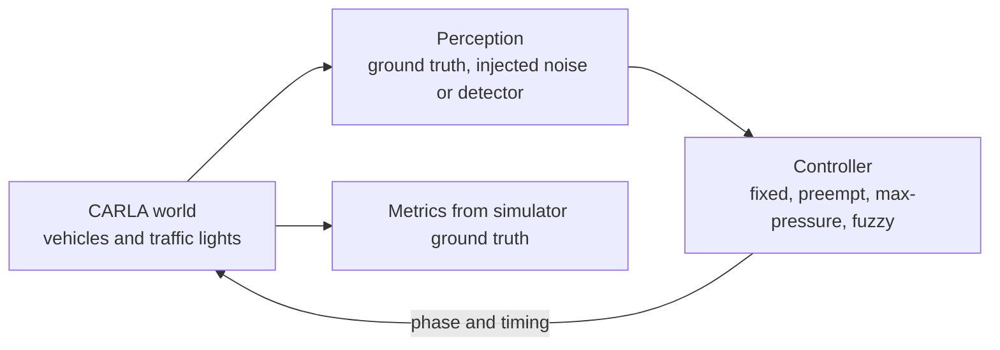


- **Simulator and junction:** CARLA 0.9.16, map `Town05_Opt`, junction index 14: four approaches (A0 to A3), two lanes each, two signal phases (A0+A2, A1+A3).
- **Scenario:** 160 s per run, 20 s warm-up, 1 s control step, 0.05 s simulation step, background traffic with inflow 0.25, 2 s all-red. One ambulance on approach A0, 25 to 38 m upstream of the stop line, spawned at a random time, identical across policies for the same seed.
- **Controllers:**

| Policy | Idea |
|---|---|
| `fixed` | fixed cycle (30 s green, 3 s yellow) |
| `preempt` | fixed cycle plus simple preemption when an emergency vehicle is detected (confidence ≥ 0.6, track age ≥ 1 s) |
| `maxpressure` | queue-pressure phase selection, green 10 to 60 s |
| `fuzzy` | fuzzy queue pressure plus emergency arbitration that minimises expected weighted delay; three modes (normal, degraded, static) driven by a perception-health signal |

- **Perception regimes:** (1) ground truth; (2) injected noise with swept parameters (not measured); (3) injected noise with rates measured offline; (4) **detector in the loop**: queues and distances come from the simulator, the emergency class from a detector run on the camera frame (hybrid mode; vision-only perception is not built).
- **Metrics (from simulator ground truth):** ambulance stopped time, ordinary-vehicle stopped time per vehicle, maximum wait, phase switches per hour, throughput, and false-preemption time. Ambulance time-to-cross is survivor-biased.
- **Reproducibility defect found and fixed:** the noise generator drew random numbers in the order of the simulator's actor list, which changes between runs. After sorting inputs with a stable key and auditing, noisy results reproduce exactly; earlier noisy results are discarded and not reported.

## 3.11 Abstract queue model and two-hop messaging

`phase2_bridge/toy_sim.py` is a simplified queue model of a corridor of signalised junctions. It is used to study messages between neighbouring junctions: a controller may receive emergency notices and state from one junction on each side (1-hop) or two junctions on each side (2-hop). The 2-hop variant, with message delay and loss, a notices-only and a state-only variant, and a hop-2 weight, is implemented and evaluated **only in this model**; it was not run in CARLA. Intervals in this model are mean ± 1.96·SE over seeds, paired by seed (normal approximation, not a bootstrap). The number of junctions and the duration are not stored in the CSV files; the script defaults (5 junctions, 900 s, 20 seeds) are the likely settings and are not verified.

## 3.12 Reproducibility

Seeds, scripts and hashes of the frozen protocol are stored with the results. The noise generator in the CARLA study originally drew random numbers in the order of the simulator's actor list, which changes between runs; after sorting inputs with a stable key and an audit, noisy results reproduce exactly, and earlier noisy results are discarded. Appendix D lists commands.

---

# 4. Results

## 4.1 Part I: detectors, ensembles and stacking (DEV)

<p align="center"></p>

RT-DETR-l reaches **0.9078** mAP50 and YOLOv8n **0.8815**; Faster R-CNN (60 epochs) reaches 0.8508 (0.8424 in the first 15-epoch run). Stacking with logistic regression reaches 0.9076, which differs from RT-DETR-l by -0.0002; soft average and WBF stay below RT-DETR-l.

| method | mAP50 | mAP50-95 | AP50 police | AP50 ambulance |
|---|---|---|---|---|
| YOLOv8n | 0.8815±0.0203 | 0.7593±0.0155 | 0.9695±0.0283 | 0.9666±0.0202 |
| RT-DETR-l | 0.9078±0.0172 | 0.7923±0.0173 | 0.9842±0.0186 | 0.9783±0.0171 |
| Faster R-CNN | 0.8508±0.0278 | 0.7035±0.0236 | 0.9579±0.0462 | 0.9538±0.0200 |
| NMS union | 0.8824±0.0228 | 0.7315±0.0223 | 0.9723±0.0317 | 0.9814±0.0145 |
| WBF | 0.9007±0.0223 | 0.7820±0.0197 | 0.9805±0.0262 | 0.9819±0.0140 |
| Top-1 | 0.8754±0.0261 | 0.7270±0.0252 | 0.9586±0.0355 | 0.9736±0.0114 |
| Soft average | 0.9063±0.0187 | 0.7523±0.0195 | 0.9807±0.0265 | 0.9813±0.0146 |
| Stacking: LR | 0.9076±0.0186 | 0.7453±0.0166 | 0.9757±0.0296 | 0.9781±0.0165 |
| Stacking: HGB | 0.8947±0.0139 | 0.7359±0.0187 | 0.9390±0.0322 | 0.9775±0.0168 |
| Stacking: RF | 0.9013±0.0216 | 0.7446±0.0213 | 0.9768±0.0314 | 0.9781±0.0163 |
| Stacking: SVM | 0.8824±0.0257 | 0.7164±0.0258 | 0.9702±0.0340 | 0.9708±0.0194 |
| Stacking: MLP | 0.9023±0.0199 | 0.7439±0.0220 | 0.9600±0.0495 | 0.9796±0.0150 |
| Stacking: KNN | 0.8924±0.0233 | 0.7366±0.0244 | 0.9745±0.0355 | 0.9747±0.0212 |

<p align="center">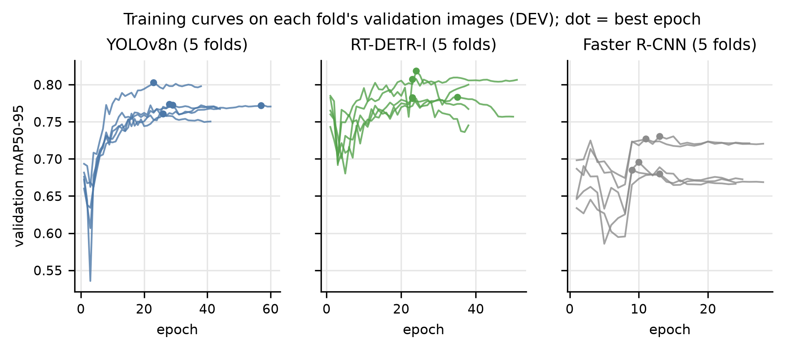</p>

*Validation mAP50-95 per epoch for every fold (DEV); the dot marks the selected epoch.*

<p align="center">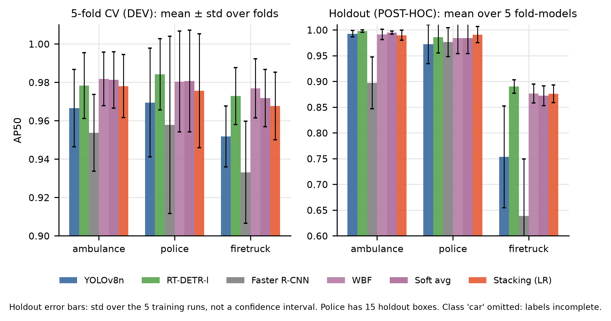</p>

*Per-class AP50: cross-validation (DEV, mean ± std over folds) and holdout (POST-HOC, error bars: std over the five training runs, not a confidence interval). Class `car` is omitted because its labels are incomplete.*

<p align="center">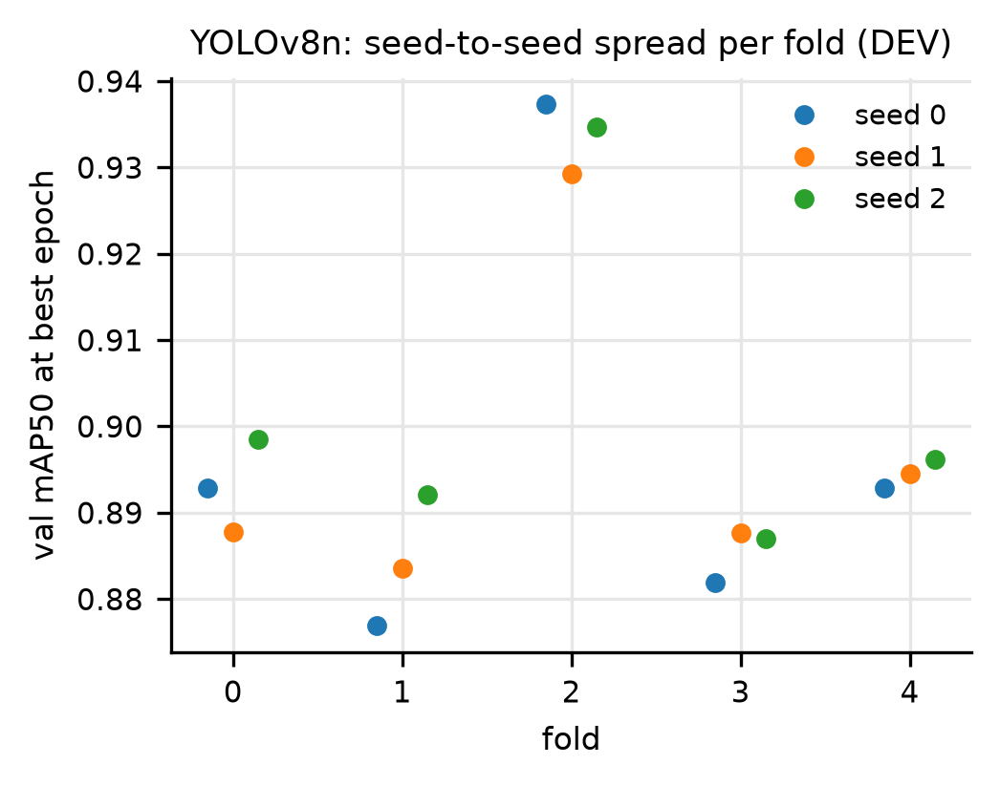</p>

*Seed-to-seed spread of YOLOv8n best-epoch validation mAP50 per fold (DEV).*

## 4.2 Cascade: accuracy versus cost (DEV)

<p align="center"></p>

| policy | escalation | mAP50 | expected ms/img |
|---|---|---|---|
| light_only | 0.00 | 0.8815±0.0203 | 5.2 |
| heavy_only | 1.00 | 0.9078±0.0172 | 27.3 |
| band<0.4 | 0.15 | 0.8892±0.0142 | 9.4 |
| band<0.5 | 0.19 | 0.8942±0.0165 | 10.5 |
| band<0.6 | 0.22 | 0.8973±0.0170 | 11.2 |
| band<0.7 | 0.25 | 0.8981±0.0165 | 12.0 |
| band<0.8 | 0.28 | 0.8999±0.0159 | 12.8 |
| band<0.9 | 0.35 | 0.9036±0.0189 | 14.9 |

The frozen policy `band<0.7` escalates 25% of the images and reaches **0.8981** mAP50 at **12.0 ms** per image, against 5.2 ms for the light model and 27.3 ms for the heavy model alone. That is 44% of the heavy-model time at a cost of 0.0097 mAP50 (DEV).

**Negative result (DEV).** The cascade was also tried with Faster R-CNN as the heavy model or as a second tier. Any cascade that sends images to Faster R-CNN costs the same or more and is the same or less accurate than the frozen `r|b1<0.7` policy; sending images to both heavy models does not improve accuracy either. The full table is in Appendix B.

## 4.3 Model cost

<p align="center"></p>

<function bench_tbl at 0x71473d1756c0>

*NVIDIA GeForce RTX 5060 Laptop GPU; 100 images, fold 0; timing is unstable.*

## 4.4 Holdout (POST-HOC)

The holdout had already been consumed by the first run, so these numbers carry the label POST-HOC even though the v4 protocol was frozen before this evaluation (2026-11-20 21:59:31). The first run's holdout numbers (FROZEN-ONCE) are in Appendix A. Values are means over five fold-models; intervals are 95% group-bootstrap intervals.

<p align="center">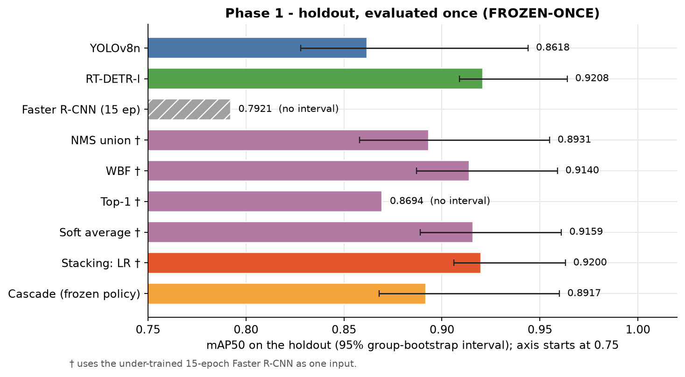</p>

| method | mAP50 | CI95 (group bootstrap) | AP50 police | police CI95 |
|---|---|---|---|---|
| YOLOv8n | 0.8618 | [0.828, 0.944] | 0.972 | [0.921, 1.000] |
| RT-DETR-l | 0.9208 | [0.909, 0.964] | 0.986 | [0.960, 1.000] |
| Faster R-CNN | 0.7709 | - | 0.976 | - |
| NMS union | 0.8830 | [0.844, 0.950] | 0.985 | [0.959, 1.000] |
| WBF | 0.9116 | [0.883, 0.957] | 0.985 | [0.957, 1.000] |
| Top-1 | 0.8590 | - | 0.958 | - |
| Soft average | 0.9136 | [0.884, 0.960] | 0.985 | [0.957, 1.000] |
| Stacking: LR | 0.9211 | [0.906, 0.965] | 0.991 | [0.972, 1.000] |
| Cascade (frozen policy) | 0.8917 | [0.868, 0.960] | 0.972 | [0.921, 1.000] |

| Method | mAP50 | AP50 ambulance | AP50 police | AP50 firetruck | AP50 car |
|---|---|---|---|---|---|
| YOLOv8n | 0.8618 | 0.993 | 0.972 | 0.754 | 0.728 |
| RT-DETR-l | 0.9208 | 0.998 | 0.986 | 0.890 | 0.809 |
| Faster R-CNN | 0.7709 | 0.897 | 0.976 | 0.639 | 0.571 |
| NMS union | 0.8830 | 0.982 | 0.985 | 0.849 | 0.716 |
| WBF | 0.9116 | 0.991 | 0.985 | 0.876 | 0.794 |
| Top-1 | 0.8590 | 0.959 | 0.958 | 0.804 | 0.714 |
| Soft average | 0.9136 | 0.995 | 0.985 | 0.872 | 0.803 |
| Stacking (LR) | 0.9211 | 0.990 | 0.991 | 0.876 | 0.828 |
| Cascade (frozen) | 0.8917 | 0.995 | 0.972 | 0.815 | 0.785 |

<p align="center"></p>

| Comparison | Mean difference in mAP50 | 95% group-bootstrap interval | Interval excludes 0 |
|---|---|---|---|
| Cascade − RT-DETR-l | -0.0215 | [-0.0420, -0.0035] | yes |
| Cascade − YOLOv8n | +0.0232 | [+0.0043, +0.0451] | yes |
| Stacking (LR) − RT-DETR-l | +0.0016 | [-0.0068, +0.0079] | no |
| Soft average − RT-DETR-l | -0.0076 | [-0.0305, +0.0040] | no |
| WBF − RT-DETR-l | -0.0097 | [-0.0328, +0.0018] | no |
| Stacking (LR) − WBF | +0.0113 | [+0.0052, +0.0289] | yes |

**Reading.** Stacking brings no measurable gain over RT-DETR-l (+0.0016 [-0.0068, +0.0079]). The cascade is worse than the heavy model (-0.0215, interval excludes 0) and better than the light model (+0.0232, interval excludes 0), so it is a speed/accuracy trade-off, not an accuracy gain. Stacking is better than WBF (+0.0113), but WBF is not itself better than RT-DETR-l. The escalation rate on the holdout was 27.6% (mean over five fold-models) against 25.0% in cross-validation.

## 4.5 COCO benchmark of the same methods (FROZEN-ONCE on the test half)

<p align="center">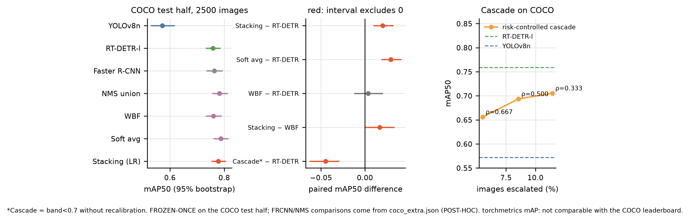</p>

| Method | mAP50 | 95% bootstrap interval |
|---|---|---|
| YOLOv8n | 0.5718 | [0.531, 0.616] |
| RT-DETR-l | 0.7584 | [0.734, 0.784] |
| Faster R-CNN | 0.7635 | [0.737, 0.792] |
| NMS union | 0.7823 | [0.758, 0.810] |
| WBF | 0.7605 | [0.735, 0.788] |
| Soft average | 0.7873 | [0.763, 0.813] |
| Stacking (LR) | 0.7781 | [0.755, 0.803] |

Paired differences on the test half (95% bootstrap intervals):

| Comparison | Mean difference in mAP50 | 95% bootstrap interval | Interval excludes 0 |
|---|---|---|---|
| Stacking (LR) − RT-DETR-l | +0.0203 | [+0.0102, +0.0317] | yes |
| Soft average − RT-DETR-l | +0.0295 | [+0.0195, +0.0407] | yes |
| WBF − RT-DETR-l | +0.0036 | [-0.0117, +0.0195] | no |
| Stacking (LR) − WBF | +0.0167 | [+0.0010, +0.0328] | yes |
| Cascade (band<0.7, no recalibration) − RT-DETR-l | -0.0449 | [-0.0624, -0.0301] | yes |
| Faster R-CNN − RT-DETR-l (added later, POST-HOC) | +0.0057 | [-0.0164, +0.0239] | no |
| Soft average − Faster R-CNN (added later, POST-HOC) | +0.0232 | [+0.0137, +0.0349] | yes |

Risk-controlled cascade on COCO (threshold calibrated on the development half):

| Risk level ρ | Images escalated | mAP50 | Cascade − RT-DETR-l | Share of light-to-heavy gap closed (median, 95%) | Share closed by random routing, same escalation (median, 95%) |
|---|---|---|---|---|---|
| 0.333 | 11.4% | 0.7054 | -0.0517 [-0.0684, -0.0378] | 0.72 [0.64, 0.81] | +0.02 [-0.04, +0.09] |
| 0.500 | 8.6% | 0.6935 | -0.0631 [-0.0837, -0.0451] | 0.66 [0.55, 0.77] | -0.01 [-0.07, +0.07] |
| 0.667 | 5.5% | 0.6561 | -0.0995 [-0.1226, -0.0790] | 0.46 [0.33, 0.60] | -0.01 [-0.06, +0.06] |

**Reading.** On COCO, soft average and stacking beat RT-DETR-l by a small amount; WBF does not. The cascade closes much more of the light-to-heavy gap than random routing at the same escalation rate but stays below the heavy model. The emergency-vehicle data therefore do not show the small ensemble gain that COCO shows (Chapter 5).

## 4.6 Leakage audit of the holdout (POST-HOC)

Perceptual-hash audit (difference hash, distance ≤ 4 of 64 bits, mirrored copies included) of the holdout images against the training folds:

| A (holdout) | B (training folds) | near-duplicates of A found in B |
|---|---|---|
| `holdout_v3` | `folds_v3/fold_0` (28788 images) | 0 of 381 |
| `holdout_v3` | `folds_v3/fold_4` (28779 images) | 0 of 381 |
| `holdout_v4` | `folds_v3/fold_0` (28788 images) | 0 of 381 |

Zero near-duplicates were found. The method does not detect different frames of the same video or scene, so zero is not proof of independence. Exact (md5) overlap of `holdout_v3` with `folds_v3` is also 0 of 381. The earlier holdout (`holdout_eval`, 1036 images) overlapped 95.5% with the training folds and is not used.

## 4.7 Part II: policies without perception error (CARLA)

<p align="center"></p>

| Policy | Ambulance stopped (s) | Stopped per ordinary vehicle (s) | Max wait (s) | Switches / h | Ordinary vehicles / min |
|---|---|---|---|---|---|
| fixed | 7.30 | 7.74 | 33.30 | 102.9 | 7.37 |
| preempt | 2.00 | 7.16 | 32.00 | 113.1 | 7.24 |
| maxpressure | 5.80 | **2.73** | **13.50** | 156.9 | 6.64 |
| fuzzy | 2.20 | 4.41 | 31.60 | 100.3 | 6.64 |

*10 seeds; means. Fuzzy minus preempt, paired by seed (95% bootstrap interval): ambulance stopped +0.20 s [+0.00, +0.50]; stopped per ordinary vehicle -2.75 s [-4.45, -1.23].*

## 4.8 Part II: detectors on CARLA frames (domain gap)

<p align="center">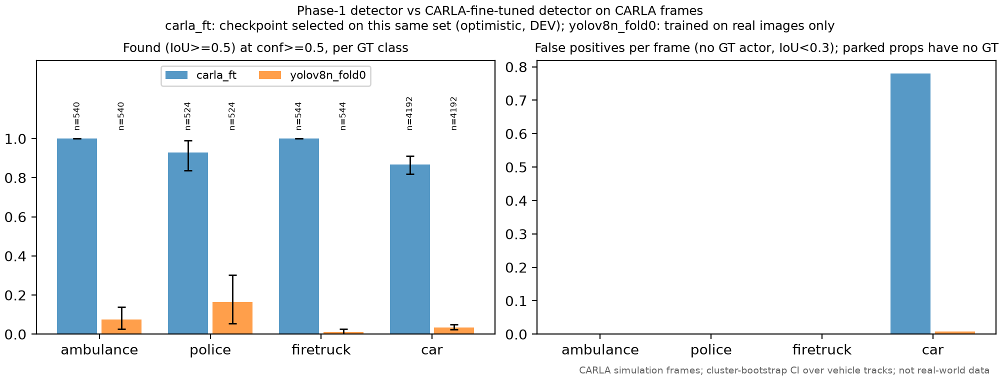</p>

- A detector trained on real images only (`yolov8n_fold0`) finds few vehicles in CARLA frames (validation capture, conf ≥ 0.5, found rate: ambulance 0.07, police 0.16, firetruck 0.01, car 0.03).
- After fine-tuning on CARLA frames, the validation capture gives ambulance 1.00, police 0.93, firetruck 1.00, car 0.87 (checkpoint selected on it: **DEV**). On the held-out capture (new camera pose and seeds; same junction and vehicle models): ambulance 0.99, police 0.88, firetruck 0.99, car 0.75.

<p align="center">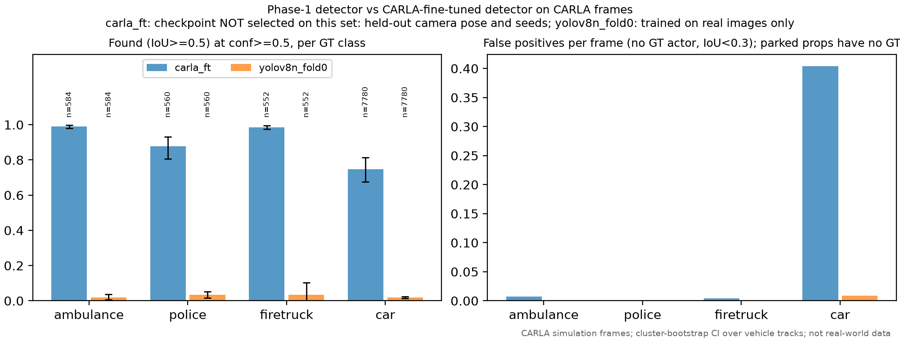</p>

## 4.9 Part II: injected noise versus detector in the loop (CARLA)

<p align="center"></p>

<p align="center">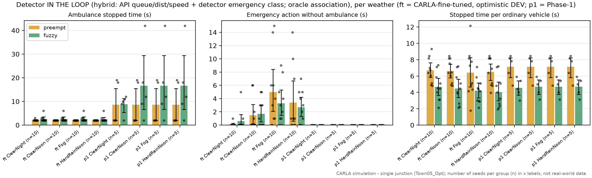</p>

- With the CARLA-fine-tuned detector in the loop the ambulance is recognised in nearly all visible frames; **fuzzy shows no advantage over preempt** for the ambulance (+0.5 to +0.6 s, lower interval bound 0.0 s). Ordinary vehicles stop about 2.0 to 2.5 s less per vehicle under fuzzy (interval excludes 0 in all four weather conditions; the four weather conditions share the same traffic scenes, so these are not four independent confirmations).
- With the detector trained on real images only, the ambulance is almost never recognised in the loop.
- False emergency action is about 23 to 75 s per run with injected measured-rate noise and about 0 to 5 s with the detector in the loop. Injected noise is a **pessimistic stress test, not a prediction**; the cause is not tested (hypothesis: injected false alarms persist 1 to 5 s by assumption).

## 4.10 Part II: simulator renders (CARLA)

<p align="center"></p>

<p align="center">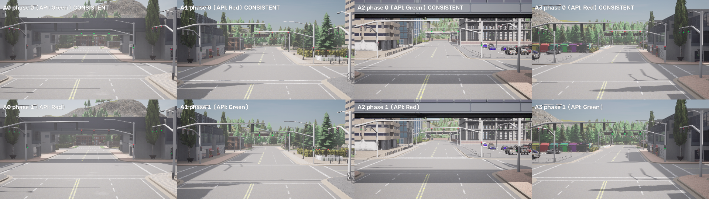</p>

*Row 1: phase 0 (A0 and A2 green); row 2: phase 1 (A1 and A3 green). The mapping between lights and approaches is checked by stop-line distance (mismatch ≤ 0.01 m), by behaviour, by pixel colour counts and by eye.*

**Animation (CARLA simulation).** The same seed under two policies, side by side; the policy of each panel is printed in its header. One junction, one run per policy, a 16 s excerpt of a 32 s clip. This is an illustration, **not a result**; averages over seeds are in Section 4.7. Click the animation for the full MP4.

<p align="center"><a href="docs/media/carla_fixed_vs_fuzzy_s0.mp4">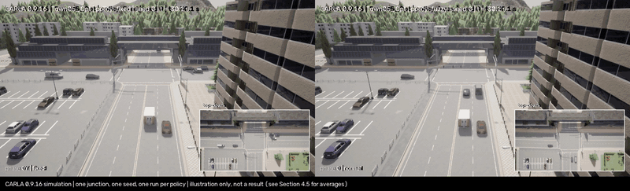</a></p>

The full Phase 2 report (all tables, protocols, per-weather results) is in [`phase2_bridge/README.md`](phase2_bridge/README.md).

## 4.11 Abstract queue model and two-hop messaging (abstract queue model)

> [!WARNING]
> Nothing in this section is evidence about CARLA or real traffic.

`phase2_bridge/toy_sim.py` is a simplified queue model of a corridor. **Nothing in this section is evidence about CARLA or real traffic.** The full tables (20 seeds, paired by seed, plus a 3-junction run with 10 seeds) are generated from the CSV files in [`phase2_bridge/ABSTRACT_MODEL.md`](phase2_bridge/ABSTRACT_MODEL.md).

- With messages to one junction each way, the fuzzy controller lowers the emergency delay against simple preemption and against no communication at the base demand, at a small cost for ordinary traffic and at a measured cost in false-preemption time.
- Extending the messages to two junctions each way does **not** help at the base demand (ordinary delay is higher in every seed, emergency delay is unchanged within the interval) and gains nothing under the tested message delays or losses either.
- In saturated demand (spillbacks present), the two-hop emergency notices reduce emergency delay and spillbacks; the two-hop pressure term alone has no measurable effect. The hop-2 weight made no difference at the base demand.
- Messaging to two junctions each way exists only in this model; it was not run in CARLA.

**Animation (abstract queue model, not CARLA).** Three junctions, base demand (lam 0.12), seed 11, 600 s, three emergency vehicles. Top row: fuzzy controller (full); bottom row: fixed-time; same demand and vehicles. This is an illustration of the abstract queue model, **not a result and not evidence about CARLA or real traffic**. Click the animation for the MP4.

<p align="center"><a href="docs/media/p2_corridor_fuzzy_vs_fixed.mp4">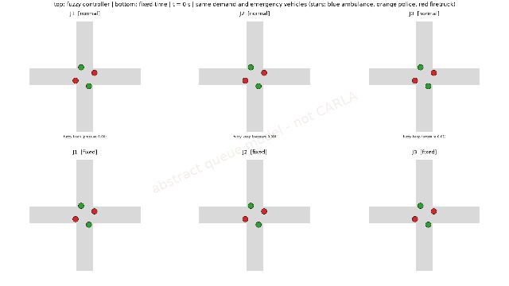</a></p>

#### Policies on the corridor (demand λ = 0.12)

| policy | emergency delay, corridor (s) | ordinary delay (s) | max wait (s) | false-preempt time (s) | throughput (veh/h) |
|---|---|---|---|---|---|
| Fixed-time | 61.54 | 13.76 | 37.65 | 0.00 | 6752.40 |
| Fixed+preempt | 17.96 | 13.93 | 53.60 | 0.00 | 6753.00 |
| Max-pressure | 37.99 | 8.45 | 22.95 | 0.00 | 6798.60 |
| Fuzzy (no comm) | 15.95 | 9.50 | 46.25 | 0.00 | 6783.40 |
| Fuzzy (full) | 5.89 | 10.71 | 53.75 | 109.95 | 6782.60 |
| Fuzzy (2-hop) | 7.34 | 12.04 | 54.35 | 96.10 | 6782.40 |

Means over seeds. `Fuzzy (full)` = 1-hop messages; `Fuzzy (2-hop)` = messages to 2 junctions each way.

Paired differences of `Fuzzy (full)` minus another policy (mean ± 1.96·SE; negative emergency/ordinary delay = Fuzzy better):

| versus | emergency delay (s) | ordinary delay (s) | max wait (s) |
|---|---|---|---|
| Fuzzy (no comm) | -10.06 ± 2.04 | +1.22 ± 0.18 | +7.50 ± 2.39 |
| Fixed+preempt | -12.07 ± 4.05 | -3.22 ± 0.26 | +0.15 ± 3.12 |
| Max-pressure | -32.10 ± 4.37 | +2.26 ± 0.22 | +30.80 ± 1.27 |
| Fixed-time | -55.65 ± 2.27 | -3.04 ± 0.11 | +16.10 ± 0.35 |

#### 2-hop minus 1-hop under message delay and loss

Negative is better for the delay columns. 'seeds worse' = seeds where 2-hop was higher than 1-hop.

| message delay (s) | drop prob. | emergency delay (s) | ordinary delay (s) | ordinary: seeds worse | max wait (s) | false-preempt (s) |
|---|---|---|---|---|---|---|
| 0 | 0 | +1.45 ± 1.62 | +1.33 ± 0.11 | 20/20 | +0.60 ± 0.22 | -13.85 ± 5.77 |
| 2 | 0 | +0.49 ± 1.42 | +1.20 ± 0.10 | 20/20 | +0.95 ± 0.46 | -9.65 ± 5.03 |
| 0 | 0.2 | -1.06 ± 2.22 | +1.19 ± 0.11 | 20/20 | +0.95 ± 0.33 | -3.75 ± 8.99 |
| 0 | 0.5 | -1.38 ± 2.22 | +0.93 ± 0.20 | 19/20 | +1.00 ± 0.75 | +7.05 ± 8.74 |

#### Where does 2-hop help? Demand sweep

Variants: `state-only` = hop-2 occupancy enters the pressure term, no 2-ahead notices; `notices-only` = notices, no hop-2 pressure; `both`.

Regime of the 1-hop controller at each demand (means):

| lam | ordinary delay (s) | spillbacks/h | throughput (veh/h) |
|---|---|---|---|
| 0.12 | 10.7 | 0.0 | 6783 |
| 0.2 | 31.1 | 0.0 | 10928 |
| 0.28 | 128.6 | 285.2 | 12211 |
| 0.32 | 203.8 | 783.6 | 11783 |

Difference variant − 1-hop (mean ± 1.96·SE):

| lam | variant | emergency delay (s) | ordinary delay (s) | spillbacks/h | max wait (s) |
|---|---|---|---|---|---|
| 0.12 | 2hop state-only | +0.00 ± 0.00 | +0.00 ± 0.00 | +0.00 ± 0.00 | +0.00 ± 0.00 |
| 0.12 | 2hop notices-only | +1.45 ± 1.62 | +1.33 ± 0.11 | +0.00 ± 0.00 | +0.60 ± 0.22 |
| 0.12 | 2hop both | +1.45 ± 1.62 | +1.33 ± 0.11 | +0.00 ± 0.00 | +0.60 ± 0.22 |
| 0.2 | 2hop state-only | +0.56 ± 0.69 | -0.06 ± 0.16 | +0.00 ± 0.00 | -0.15 ± 0.41 |
| 0.2 | 2hop notices-only | -11.04 ± 2.26 | +3.02 ± 0.53 | +0.00 ± 0.00 | +3.45 ± 1.90 |
| 0.2 | 2hop both | -11.20 ± 2.16 | +3.00 ± 0.51 | +0.00 ± 0.00 | +3.60 ± 1.87 |
| 0.28 | 2hop state-only | +0.70 ± 3.27 | -0.51 ± 1.09 | -28.60 ± 64.34 | -1.20 ± 2.35 |
| 0.28 | 2hop notices-only | -44.29 ± 7.23 | +2.39 ± 1.44 | -209.80 ± 130.48 | -1.20 ± 2.35 |
| 0.28 | 2hop both | -43.79 ± 7.06 | +2.38 ± 1.50 | -205.00 ± 122.69 | -1.05 ± 2.06 |
| 0.32 | 2hop state-only | +2.62 ± 3.12 | +1.52 ± 1.26 | +34.80 ± 78.90 | -0.55 ± 2.61 |
| 0.32 | 2hop notices-only | -69.72 ± 11.93 | -1.78 ± 2.71 | -652.40 ± 173.59 | -3.15 ± 2.45 |
| 0.32 | 2hop both | -67.55 ± 12.43 | -0.91 ± 2.69 | -651.40 ± 172.61 | -3.15 ± 2.45 |

#### Hop-2 weight sweep

| policy | weight | ordinary delay (s) | emergency delay (s) | false-preempt (s) | max wait (s) |
|---|---|---|---|---|---|
| 1-hop | - | 10.713 | 5.888 | 109.95 | 53.75 |
| 2-hop | 0 | 12.039 | 7.338 | 96.10 | 54.35 |
| 2-hop | 0.25 | 12.039 | 7.338 | 96.10 | 54.35 |
| 2-hop | 0.5 | 12.039 | 7.338 | 96.10 | 54.35 |
| 2-hop | 0.75 | 12.039 | 7.338 | 96.10 | 54.35 |
| 2-hop | 1 | 12.039 | 7.338 | 96.10 | 54.35 |

All 2-hop rows are identical across weights: at this demand the weight had no measured effect.

#### Earlier 3-junction run

File: outputs/p2_policy_runs.csv (stored 2026-11-04, before the multi-hop code of 2026-11-13; not re-run with the current code). Different setting from sections 1-4: do not mix them.

| lam | policy | emergency delay (s) | ordinary delay (s) | throughput (veh/h) | max wait (s) |
|---|---|---|---|---|---|
| 0.08 | Fixed+preempt | 2.58 | 12.80 | 2844 | 52.00 |
| 0.08 | Fixed-time | 18.48 | 11.66 | 2839 | 37.20 |
| 0.08 | Fuzzy (full) | 0.55 | 9.46 | 2851 | 53.00 |
| 0.08 | Fuzzy (no comm) | 1.50 | 8.93 | 2851 | 44.00 |
| 0.08 | Fuzzy (no priority) | 16.15 | 8.54 | 2851 | 38.20 |
| 0.08 | Max-pressure | 11.90 | 6.85 | 2855 | 21.30 |
| 0.12 | Fixed+preempt | 5.62 | 15.26 | 4236 | 55.90 |
| 0.12 | Fixed-time | 20.82 | 13.35 | 4249 | 37.50 |
| 0.12 | Fuzzy (full) | 1.55 | 10.12 | 4264 | 51.20 |
| 0.12 | Fuzzy (no comm) | 2.35 | 9.49 | 4266 | 44.00 |
| 0.12 | Fuzzy (no priority) | 17.57 | 9.00 | 4264 | 36.40 |
| 0.12 | Max-pressure | 14.15 | 8.51 | 4272 | 21.00 |
| 0.16 | Fixed+preempt | 7.78 | 18.08 | 5634 | 52.30 |
| 0.16 | Fixed-time | 22.88 | 16.16 | 5654 | 37.80 |
| 0.16 | Fuzzy (full) | 3.58 | 14.63 | 5669 | 51.70 |
| 0.16 | Fuzzy (no comm) | 5.15 | 13.31 | 5670 | 42.50 |
| 0.16 | Fuzzy (no priority) | 23.18 | 12.38 | 5674 | 36.40 |
| 0.16 | Max-pressure | 25.45 | 14.18 | 5670 | 27.20 |

Paired difference `Fuzzy (full)` minus other (mean ± 1.96·SE over 10 seeds):

| lam | versus | emergency delay (s) | ordinary delay (s) |
|---|---|---|---|
| 0.08 | Fuzzy (no comm) | -0.95 ± 0.72 | +0.52 ± 0.19 |
| 0.08 | Fixed+preempt | -2.02 ± 0.99 | -3.34 ± 0.40 |
| 0.08 | Max-pressure | -11.35 ± 2.88 | +2.61 ± 0.21 |
| 0.08 | Fixed-time | -17.93 ± 3.79 | -2.20 ± 0.41 |
| 0.12 | Fuzzy (no comm) | -0.80 ± 1.29 | +0.63 ± 0.28 |
| 0.12 | Fixed+preempt | -4.08 ± 3.08 | -5.14 ± 0.42 |
| 0.12 | Max-pressure | -12.60 ± 2.89 | +1.61 ± 0.38 |
| 0.12 | Fixed-time | -19.27 ± 3.98 | -3.23 ± 0.50 |
| 0.16 | Fuzzy (no comm) | -1.57 ± 2.16 | +1.32 ± 0.76 |
| 0.16 | Fixed+preempt | -4.20 ± 3.22 | -3.45 ± 1.13 |
| 0.16 | Max-pressure | -21.88 ± 6.94 | +0.45 ± 0.92 |
| 0.16 | Fixed-time | -19.30 ± 3.64 | -1.53 ± 0.97 |

---

# 5. Discussion

## 5.1 Part I

- **The cascade is a cost lever, not an accuracy lever.** It recovers most of the gap between the light and heavy model at 44% of the heavy model's time in cross-validation, but on the holdout it stays below the heavy model alone.
- **Stacking adds nothing measurable** on the emergency data: the paired difference to RT-DETR-l is +0.0016 [-0.0068, +0.0079] on the holdout.
- **Retraining Faster R-CNN changed nothing important.** Under the shared protocol its cross-validation mAP50 moved by +0.0084 (0.8424 to 0.8508); it stays the weakest of the three models and no ensemble, stacking or cascade variant that uses it beats RT-DETR-l alone.
- **On COCO the picture differs a little.** Soft average and stacking beat RT-DETR-l by a small amount there, while on the emergency data they do not (Section 4.5 versus Section 4.4).

**Why the COCO result may differ.** The three COCO detectors were trained by others on COCO; the emergency-vehicle detectors were trained and selected on a four-class set where the best single model is already strong (RT-DETR-l) and where the other models are clearly weaker. When one member is much better than the rest, averaging has little to add; on COCO the three members are closer to each other (RT-DETR-l and Faster R-CNN differ by +0.0057, interval including 0). This is an interpretation, not a tested cause.

## 5.2 Part II

- **Priority.** Simple preemption already reaches the floor of about 2 s of ambulance stopped time; the fuzzy controller matches it but does not beat it, with or without perception error.
- **Ordinary traffic.** Max-pressure is clearly best for ordinary traffic in the clean regime; fuzzy improves on preempt (-2.75 s per vehicle) but not on max-pressure.
- **Perception matters more than the controller.** The detector trained on real images fails on CARLA frames, and fine-tuning closes the gap only within the same junction and vehicle models.
- **Method.** An ordering defect in the noise generator made noisy runs irreproducible; finding and fixing it changed which results can be reported.

## 5.3 Threats to validity

- One junction on one map; the held-out CARLA capture uses the same junction and the same vehicle models, so it is not a new environment.
- Weather conditions share the same traffic scene for equal seeds; they are not independent repetitions. Weather-visibility proxy is uncalibrated.
- The fine-tuned detector's validation-set numbers are DEV and optimistic.
- Injected-noise experiments are stress tests; their parameters are not measurements of a real system.
- Car labels in the validation and holdout data are incomplete, so car AP is not a clean metric. `holdout_v3` and `holdout_v4` contain the same 381 image names and 49 label files differ.
- The holdout is consumed, so its numbers are POST-HOC for the second run. The near-duplicate audit (Section 4.6) found no overlap but cannot see different frames of one scene. Police has very few holdout boxes, so any police number needs its interval.
- GPU timing on the laptop is unstable; use it for ordering, not for precise ratios.
- No real-world data: the simulation-to-reality gap is not measured here.

- The abstract queue model is a simplification; its tables are about the model, not about traffic.
- The number of seeds is small (10 in CARLA, 20 in the abstract model); intervals are normal or bootstrap intervals over seeds and not predictions.

## 5.4 Negative and neutral results (summary)

| Question | Result | Label |
|---|---|---|
| Does retraining Faster R-CNN to the shared protocol change conclusions? | No (CV mAP50 0.8424 → 0.8508) | DEV |
| Does stacking beat RT-DETR-l on emergency-vehicle data? | No measurable gain | POST-HOC |
| Does a cascade through Faster R-CNN help? | No: no cheaper, no more accurate | DEV |
| Does the cascade match the heavy model on the holdout? | No: below it | POST-HOC |
| Does the fuzzy controller beat simple preemption for the ambulance? | No (matches it); lower ordinary-vehicle stopping | CARLA |
| Does 2-hop messaging help at base demand? | No (ordinary delay higher in 20 of 20 seeds) | abstract queue model |
| Does the hop-2 weight matter at base demand? | No measured effect | abstract queue model |

---

# 6. Conclusion and future work

## 6.1 Summary

RT-DETR-l is the most accurate of the three detectors; the cascade keeps most of its accuracy for a fraction of its cost in cross-validation (12.0 ms against 27.3 ms) but stays below it on the holdout. Stacking gives no gain on the emergency-vehicle data and a small gain on COCO. In closed loop in CARLA, a fuzzy emergency-aware controller matches simple preemption for the ambulance and lowers ordinary-vehicle stopping time, but does not beat preemption for the ambulance, with or without perception error; perception quality in simulation is dominated by the domain gap, and injected noise gives pessimistic but unvalidated stress tests. In the abstract queue model, messaging two junctions each way is useful only in saturated demand.

## 6.2 Future work

1. Freeze a new protocol before any further holdout evaluation; a new, untouched holdout would restore a FROZEN-ONCE evaluation.
2. Extend the CARLA study to several junctions with two-hop message passing (implemented and run only in the abstract queue model so far).
3. Build vision-only perception (queues and distances from images) and calibrate the weather-visibility proxy.
4. Validate on real footage and a second map before making any claim about real traffic.

---

# References

1. E. J. Nelson and D. Bullock, "Impact of emergency vehicle preemption on signalized corridor operation: An evaluation," Transportation Research Record, vol. 1727, no. 1, 2000, doi: 10.3141/1727-01.
2. Y.-Y. Chen, J.-Y. Wang, S.-C. Lo, and W.-T. Sung, "An emergency vehicle traffic signal preemption system considering queue spillbacks along routes and negative impacts on non-priority traffic," IET Intelligent Transport Systems, vol. 18, no. 8, pp. 1385–1395, Aug. 2024.
3. E. Akdag, E. Bondarev, and P. H. N. de With, "Critical vehicle detection for intelligent transportation systems," in Proc. 8th Int. Conf. Vehicle Technology and Intelligent Transport Systems (VEHITS), 2022, pp. 165–171, doi: 10.5220/0010968900003191.
4. P. Maleki, A. Ramazani, H. Khotanlou, S. Ojaghi, M. Mousavi, A. Kalinin, and A. Mosavi, "Object detection for vehicles with YOLO," in Proc. IEEE 22nd World Symposium on Applied Machine Intelligence and Informatics (SAMI), 2024.
5. A. O. Ibrahim, E. P. Ephzibah, V. Mareeswari, I. Nishanth Samson, R. Nasikethan, and R. Ghazali, "Detection and classification of emergency vehicles from audio and video inputs using deep learning techniques," Journal of Soft Computing and Data Mining, vol. 6, no. 3, pp. 20–32, 2025.
6. S. Kapoor and A. Narayanan, "Leakage and the reproducibility crisis in machine-learning-based science," Patterns, vol. 4, no. 9, art. 100804, 2023, doi: 10.1016/j.patter.2023.100804.
7. H. Wei, G. Zheng, V. Gayah, and Z. Li, "A survey on traffic signal control methods," arXiv:1904.08117, 2019 (rev. Jan. 2020).
8. P. Varaiya, "The max-pressure controller for arbitrary networks of signalized intersections," in Advances in Dynamic Network Modeling in Complex Transportation Systems, S. Ukkusuri and K. Ozbay, Eds., vol. 2. New York, NY, USA: Springer, 2013, ch. 2, doi: 10.1007/978-1-4614-6243-9_2.
9. A. Kouvelas, J. Lioris, S. A. Fayazi, and P. Varaiya, "Maximum pressure controller for stabilizing queues in signalized arterial networks," Transportation Research Record, vol. 2421, no. 1, pp. 133–141, 2014, doi: 10.3141/2421-15.
10. C. P. Pappis and E. H. Mamdani, "A fuzzy logic controller for a traffic junction," IEEE Transactions on Systems, Man, and Cybernetics, vol. 7, no. 10, pp. 707–717, Oct. 1977, doi: 10.1109/TSMC.1977.4309605.
11. C.-H. Chou and J.-C. Teng, "A fuzzy logic controller for traffic junction signals," Information Sciences, 2002, doi: 10.1016/S0020-0255(02)00199-8.
12. S. Ren, K. He, R. Girshick, and J. Sun, "Faster R-CNN: Towards real-time object detection with region proposal networks," IEEE Transactions on Pattern Analysis and Machine Intelligence, vol. 39, no. 6, pp. 1137–1149, Jun. 2017, doi: 10.1109/TPAMI.2016.2577031.
13. J. Redmon, S. Divvala, R. Girshick, and A. Farhadi, "You only look once: Unified, real-time object detection," in Proc. IEEE Conference on Computer Vision and Pattern Recognition (CVPR), 2016.
14. G. Jocher, A. Chaurasia, and J. Qiu, "Ultralytics YOLO," software, version 8.0.0, 2023, AGPL-3.0. Available: https://github.com/ultralytics/ultralytics.
15. Y. Zhao, W. Lv, S. Xu, J. Wei, G. Wang, Q. Dang, Y. Liu, and J. Chen, "DETRs beat YOLOs on real-time object detection," in Proc. IEEE/CVF Conference on Computer Vision and Pattern Recognition (CVPR), 2024, arXiv:2304.08069.
16. R. Solovyev, W. Wang, and T. Gabruseva, "Weighted boxes fusion: Ensembling boxes from different object detection models," Image and Vision Computing, 2021, art. 104117, doi: 10.1016/j.imavis.2021.104117.
17. D. H. Wolpert, "Stacked generalization," Neural Networks, vol. 5, no. 2, pp. 241–259, 1992, doi: 10.1016/S0893-6080(05)80023-1.
18. P. Viola and M. Jones, "Rapid object detection using a boosted cascade of simple features," in Proc. IEEE Conference on Computer Vision and Pattern Recognition (CVPR), vol. 1, 2001, pp. 511–518.
19. A. Dosovitskiy, G. Ros, F. Codevilla, A. Lopez, and V. Koltun, "CARLA: An open urban driving simulator," in Proc. 1st Annual Conference on Robot Learning (CoRL), PMLR vol. 78, 2017, pp. 1–16.
20. R. Kohavi, "A study of cross-validation and bootstrap for accuracy estimation and model selection," in Proc. 14th Int. Joint Conf. on Artificial Intelligence (IJCAI), 1995, pp. 1137–1143.
21. B. Efron, "Bootstrap methods: Another look at the jackknife," The Annals of Statistics, vol. 7, no. 1, pp. 1–26, Jan. 1979, doi: 10.1214/aos/1176344552.
22. T.-Y. Lin, M. Maire, S. Belongie, J. Hays, P. Perona, D. Ramanan, P. Dollar, and C. L. Zitnick, "Microsoft COCO: Common objects in context," in Computer Vision – ECCV 2014, Lecture Notes in Computer Science, vol. 8693. Springer, 2014, pp. 740–755, doi: 10.1007/978-3-319-10602-1_48.


---

# Appendices

## Appendix A. First run with the 15-epoch Faster R-CNN

Frozen protocol of the first run (2026-10-28 14:33:48): meta = LR, heavy = rtdetr_l, cascade = band<0.7 (fallback = False). The Faster R-CNN of this run used 15 epochs and the last checkpoint, which did not match the other models; ensemble, stacking and cascade rows that use it as an input are affected.

**A.1 Cross-validation, first run (DEV; mean ± std over 5 folds)**

| method | mAP50 | mAP50-95 | AP50 police | AP50 ambulance |
|---|---|---|---|---|
| YOLOv8n | 0.8815±0.0203 | 0.7593±0.0155 | 0.9695±0.0283 | 0.9666±0.0202 |
| RT-DETR-l | 0.9078±0.0172 | 0.7923±0.0173 | 0.9842±0.0186 | 0.9783±0.0171 |
| Faster R-CNN | 0.8424±0.0333 | 0.6977±0.0284 | 0.9585±0.0381 | 0.9502±0.0193 |
| NMS union | 0.8773±0.0307 | 0.7229±0.0252 | 0.9705±0.0257 | 0.9798±0.0154 |
| WBF | 0.8988±0.0250 | 0.7821±0.0216 | 0.9793±0.0227 | 0.9802±0.0159 |
| Top-1 | 0.8716±0.0296 | 0.7210±0.0247 | 0.9555±0.0240 | 0.9719±0.0156 |
| Soft average | 0.9031±0.0224 | 0.7467±0.0175 | 0.9793±0.0227 | 0.9799±0.0157 |
| Stacking: LR | 0.9064±0.0221 | 0.7406±0.0194 | 0.9694±0.0293 | 0.9778±0.0168 |
| Stacking: HGB | 0.8933±0.0246 | 0.7283±0.0242 | 0.9327±0.0465 | 0.9772±0.0166 |
| Stacking: RF | 0.9002±0.0243 | 0.7423±0.0212 | 0.9699±0.0276 | 0.9784±0.0159 |
| Stacking: SVM | 0.8784±0.0351 | 0.7093±0.0260 | 0.9504±0.0520 | 0.9696±0.0200 |
| Stacking: MLP | 0.9029±0.0171 | 0.7423±0.0149 | 0.9627±0.0193 | 0.9784±0.0159 |
| Stacking: KNN | 0.8900±0.0240 | 0.7308±0.0192 | 0.9710±0.0268 | 0.9696±0.0161 |

**A.2 Holdout, first run (FROZEN-ONCE; 381 images; mean over 5 fold-models)**

| method | mAP50 | CI95 (group bootstrap) | AP50 police | police CI95 |
|---|---|---|---|---|
| YOLOv8n | 0.8618 | [0.828, 0.944] | 0.972 | [0.921, 1.000] |
| RT-DETR-l | 0.9208 | [0.909, 0.964] | 0.986 | [0.960, 1.000] |
| Faster R-CNN | 0.7921 | - | 0.984 | - |
| NMS union | 0.8931 | [0.858, 0.955] | 0.984 | [0.956, 1.000] |
| WBF | 0.9140 | [0.887, 0.959] | 0.985 | [0.957, 1.000] |
| Top-1 | 0.8694 | - | 0.958 | - |
| Soft average | 0.9159 | [0.889, 0.961] | 0.985 | [0.957, 1.000] |
| Stacking: LR | 0.9200 | [0.906, 0.963] | 0.986 | [0.960, 1.000] |
| Cascade (frozen policy) | 0.8917 | [0.868, 0.960] | 0.972 | [0.921, 1.000] |

Paired differences (95% group-bootstrap intervals):

- cascade_minus_heavy: -0.0215 CI95 [-0.0420, -0.0035]
- cascade_minus_light: +0.0232 CI95 [+0.0043, +0.0451]
- meta_minus_heavy: +0.0004 CI95 [-0.0055, +0.0059]
- softavg_minus_heavy: -0.0055 CI95 [-0.0242, +0.0041]
- wbf_minus_heavy: -0.0073 CI95 [-0.0277, +0.0029]
- meta_minus_wbf: +0.0077 CI95 [+0.0019, +0.0244]

## Appendix B. Extended cascade study (DEV)

Reference single-model mAP50 (best of RT-DETR-l, Faster R-CNN): 0.9078; target = 0.8978; selected = r|b1<0.7

| policy | esc to heavy1 | esc to heavy2 | mAP50 mean±std | expected ms/img |
|---|---|---|---|---|
| light_only | 0.00 | 0.00 | 0.8815±0.0203 | 5.2 |
| r\|b1<0.4 | 0.15 | 0.00 | 0.8892±0.0142 | 9.4 |
| r\|b1<0.5 | 0.19 | 0.00 | 0.8942±0.0165 | 10.5 |
| r\|b1<0.6 | 0.22 | 0.00 | 0.8973±0.0170 | 11.2 |
| r\|b1<0.7 | 0.25 | 0.00 | 0.8981±0.0165 | 12.0 |
| r\|b1<0.8 | 0.28 | 0.00 | 0.8999±0.0159 | 12.8 |
| r\|b1<0.9 | 0.35 | 0.00 | 0.9036±0.0189 | 14.9 |
| f\|b1<0.4 | 0.15 | 0.00 | 0.8451±0.0179 | 16.1 |
| tier2\|b1<0.4\|b2<0.5 | 0.15 | 0.12 | 0.8802±0.0169 | 17.9 |
| tier2\|b1<0.4\|b2<0.7 | 0.15 | 0.13 | 0.8782±0.0187 | 18.8 |
| f\|b1<0.5 | 0.19 | 0.00 | 0.8443±0.0189 | 19.0 |
| tier2\|b1<0.4\|b2<0.9 | 0.15 | 0.14 | 0.8783±0.0187 | 19.2 |
| fuse\|b1<0.4 | 0.15 | 0.15 | 0.8780±0.0188 | 20.2 |
| tier2\|b1<0.5\|b2<0.5 | 0.19 | 0.14 | 0.8837±0.0179 | 20.6 |
| f\|b1<0.6 | 0.22 | 0.00 | 0.8438±0.0217 | 20.7 |
| tier2\|b1<0.5\|b2<0.7 | 0.19 | 0.16 | 0.8821±0.0194 | 21.8 |
| tier2\|b1<0.6\|b2<0.5 | 0.22 | 0.15 | 0.8859±0.0187 | 22.2 |
| tier2\|b1<0.5\|b2<0.9 | 0.19 | 0.17 | 0.8824±0.0195 | 22.4 |
| f\|b1<0.7 | 0.25 | 0.00 | 0.8429±0.0179 | 22.9 |
| tier2\|b1<0.6\|b2<0.7 | 0.22 | 0.18 | 0.8844±0.0198 | 23.8 |
| tier2\|b1<0.7\|b2<0.5 | 0.25 | 0.17 | 0.8881±0.0177 | 23.9 |
| fuse\|b1<0.5 | 0.19 | 0.19 | 0.8821±0.0196 | 24.2 |
| tier2\|b1<0.6\|b2<0.9 | 0.22 | 0.19 | 0.8849±0.0201 | 24.6 |
| f\|b1<0.8 | 0.28 | 0.00 | 0.8407±0.0178 | 25.0 |
| tier2\|b1<0.8\|b2<0.5 | 0.28 | 0.18 | 0.8894±0.0175 | 25.5 |
| tier2\|b1<0.7\|b2<0.7 | 0.25 | 0.19 | 0.8866±0.0185 | 25.8 |
| fuse\|b1<0.6 | 0.22 | 0.22 | 0.8845±0.0201 | 26.7 |
| tier2\|b1<0.7\|b2<0.9 | 0.25 | 0.21 | 0.8876±0.0190 | 27.2 |
| rtdetr_only | 1.00 | 0.00 | 0.9078±0.0172 | 27.3 |
| tier2\|b1<0.8\|b2<0.7 | 0.28 | 0.21 | 0.8885±0.0180 | 27.6 |
| tier2\|b1<0.9\|b2<0.5 | 0.35 | 0.19 | 0.8929±0.0208 | 28.3 |
| tier2\|b1<0.8\|b2<0.9 | 0.28 | 0.23 | 0.8892±0.0184 | 29.4 |
| fuse\|b1<0.7 | 0.25 | 0.25 | 0.8872±0.0188 | 29.6 |
| f\|b1<0.9 | 0.35 | 0.00 | 0.8357±0.0245 | 30.5 |
| tier2\|b1<0.9\|b2<0.7 | 0.35 | 0.22 | 0.8918±0.0219 | 30.5 |
| fuse\|b1<0.8 | 0.28 | 0.28 | 0.8886±0.0184 | 32.5 |
| tier2\|b1<0.9\|b2<0.9 | 0.35 | 0.25 | 0.8914±0.0244 | 32.8 |
| fuse\|b1<0.9 | 0.35 | 0.35 | 0.8905±0.0249 | 40.2 |
| frcnn_only | 1.00 | 0.00 | 0.8508±0.0278 | 71.4 |
| wbf_heavy_only | 1.00 | 1.00 | 0.8974±0.0227 | 98.7 |

Paired per-fold differences versus the best single heavy model:

- wbf_heavy_only_minus_best_single_per_fold: mean -0.0104, std 0.0071, per fold [-0.0192, -0.0058, -0.0035, -0.0169, -0.0067]
- rtdetr_only_minus_best_single_per_fold: mean +0.0000, std 0.0000, per fold [0.0, 0.0, 0.0, 0.0, 0.0]
- frcnn_only_minus_best_single_per_fold: mean -0.0570, std 0.0136, per fold [-0.0742, -0.043, -0.0454, -0.0675, -0.0548]

## Appendix C. Repository map

| Path | Content |
|---|---|
| `datasets/` | dataset preparation, fold generation and training scripts (no data) |
| `results_v4_frcnn60/` | main run: frozen protocols, final report, cross-validation JSON, extended cascade report, holdout results (no detection dumps) |
| `results_v3/` | first run (15-epoch Faster R-CNN): protocol, report, holdout results, training logs |
| `results_coco/` | COCO benchmark results and frozen protocol |
| `stacking/`, `stacking_v4/` | ensembles, stacking, cascade, audits and benchmark scripts |
| `docs/leakage_audit/` | near-duplicate audit logs |
| `figures_pipeline/` | figure scripts and the generators of the README and of this report |
| `docs/readme_figures/`, `docs/paper_figures/`, `docs/media/` | figures and animations |
| `phase2_bridge/` | controllers, CARLA bridge, abstract queue model, tests, Part II results and report |
| `frcnn60/` | Faster R-CNN 60-epoch retraining scripts |
| `requirements_frozen.txt` | frozen package versions |

Datasets and model weights are not committed.

## Appendix D. Reproduction

```bash
pip install -r requirements_frozen.txt
python figures_pipeline/build_root_readme.py   # README and its figures from result files
python figures_pipeline/make_paper_figures.py  # docs/paper_figures from result files
python figures_pipeline/build_report.py        # docs/report/REPORT.md from result files
python figures_pipeline/build_readme_full.py   # this README = header + full report (run last)
```

Part II (CARLA 0.9.16, one run per process, seeds and gates) is described in [`phase2_bridge/README.md`](phase2_bridge/README.md); the abstract queue model tables are generated by `phase2_bridge/build_abstract_model_doc.py` into [`phase2_bridge/ABSTRACT_MODEL.md`](phase2_bridge/ABSTRACT_MODEL.md).

## Appendix E. Statement on data and claims

- Every number in Chapter 4 is read from a result file in this repository; the generator of this report is `figures_pipeline/build_report.py`.
- Claims not made: that the fuzzy controller is safer under false alarms; that it beats simple preemption for the ambulance; any real-world error rate; generalisation to other junctions; absence of leakage (the audit only finds near-identical images); conclusions from ambulance time-to-cross without noting survivor bias; conclusions from the weather-visibility proxy (uncalibrated).
- No real-world emergency-vehicle video ground truth exists; video renders are illustrations, not results.
