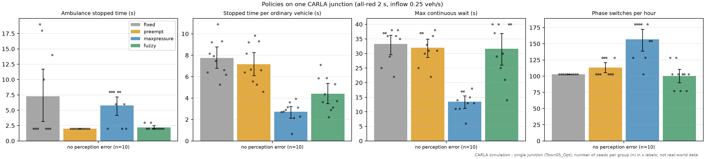
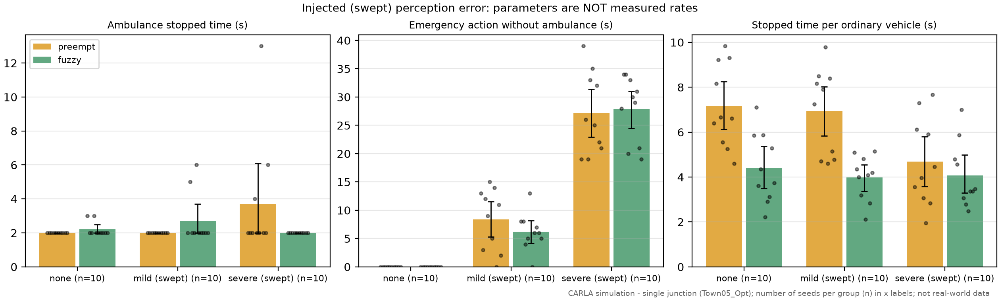
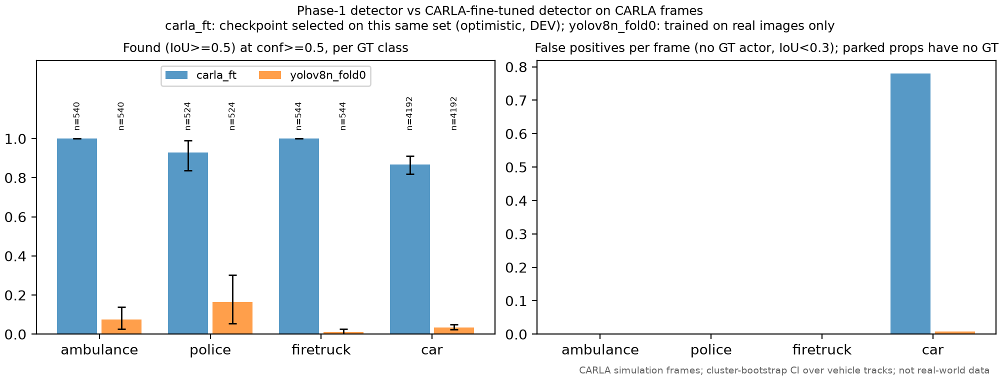
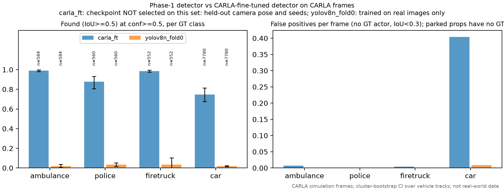
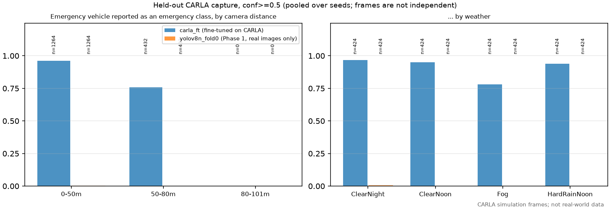
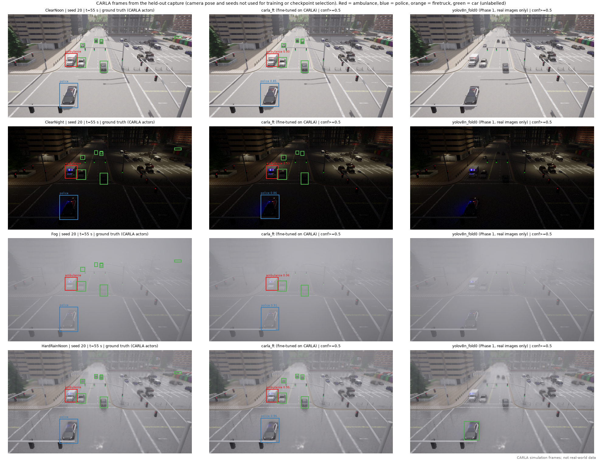
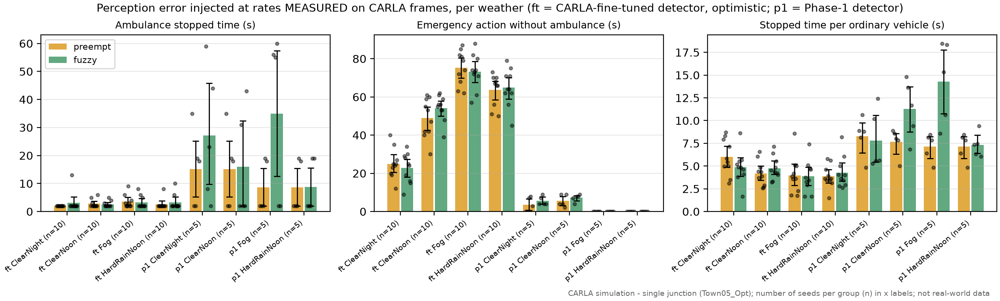
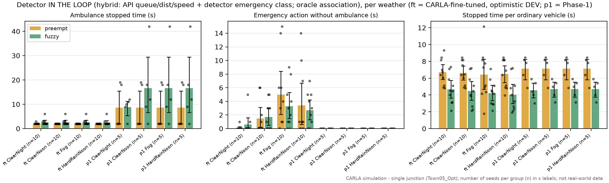
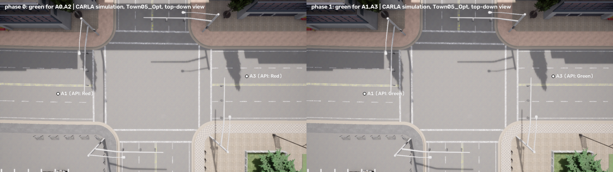
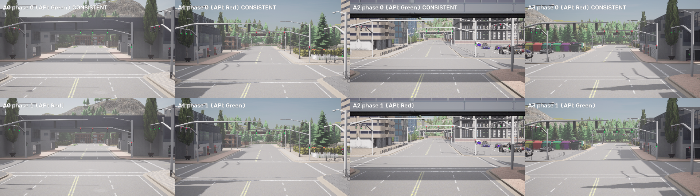

# Signal control with emergency-vehicle priority: CARLA simulation study (Phase 2)

This folder holds the closed-loop simulation study of an adaptive traffic-signal controller (a fuzzy controller with emergency-vehicle arbitration) on one junction of the CARLA simulator, with perception errors that are injected, measured, or produced by a real detector in the loop.

**All numbers in this document come from the CARLA simulator (one junction, Town05_Opt, junction index 14). They are not real-world measurements.** Numbers from the earlier abstract model (`toy_sim.py`) are not reported here.

## 1. Scope, labels and status

| Label | Meaning |
|---|---|
| CARLA | measured in the CARLA simulator, one junction |
| DEV | a choice (checkpoint, threshold, design) was made while looking at the same data: optimistic |
| injected noise | perception error added to ground truth with sweep parameters or with rates measured offline |
| detector in loop (hybrid) | an actual detector runs on a camera frame inside the control loop; parts of the pipeline stay oracle (Section 3.5) |
| survivor-biased | `amb_time_to_cross_s` is defined only for runs in which the ambulance crossed |

Status: simulation results are complete for the single junction. The mapping between traffic lights and approach labels is checked by stop-line distance (mismatch <= 0.01 m) and by behaviour (an ambulance on A0 stops behind the red of A0); the by-eye check uses the renders in Section 4.7 (its status is stated there).

## 2. Summary of findings

1. **Phase-1 detector on CARLA frames (domain gap).** A detector trained on real images only (`yolov8n_fold0`) finds few vehicles in CARLA frames (validation capture, conf >= 0.5, found rate: ambulance 0.07, police 0.16, firetruck 0.01, car 0.03).
2. **Detector fine-tuned on CARLA frames (`carla_ft`).** On the validation capture (checkpoint selected on it, DEV): ambulance 1.00, police 0.93, firetruck 1.00, car 0.87. On the held-out capture (new camera pose and seeds; same junction and same vehicle models): ambulance 0.99, police 0.88, firetruck 0.99, car 0.75. Section 4.3 gives the comparison; it does not show real-world performance.
3. **Controller comparison without perception error.** `fuzzy` and the simple `preempt` baseline give the ambulance the same stopped time (floor of about 2 s); `maxpressure` is best for ordinary traffic. Table in Section 4.1.
4. **Detector in the loop.** With the CARLA-fine-tuned detector the ambulance is recognised in nearly all visible frames, and fuzzy shows no advantage over preempt for the ambulance (difference +0.5 to +0.6 s, lower CI bound 0.0 s). Ordinary vehicles stop about 2.0 to 2.5 s less per vehicle under fuzzy (CI excludes 0 in all four weathers, but the four weathers share the same traffic scenes, so these are not four independent confirmations). With the Phase-1 detector the ambulance is almost never recognised (Section 4.4).
5. **Injected noise is a pessimistic stress test, not a prediction.** The false emergency action (`false_preempt_s`) is about 23 to 75 s per run with injected measured-rate noise and about 0 to 5 s with the detector in the loop (Section 4.5). The cause is not tested (hypothesis: the injected false alarms persist 1 to 5 s by assumption).
6. **Reproducibility defect found and fixed.** Noisy runs were not reproducible because the noise generator drew random numbers in the order of the simulator's actor list, which changes between runs (Section 3.7). All noisy results reported here were re-run after the fix and audited.

## 3. Method

### 3.1 Simulator, junction and software

* CARLA 0.9.16 (Windows), synchronous mode, fixed step 0.05 s; Python 3.12.8, `carla` 0.9.16 wheel, numpy 2.5.4, OpenCV 5.0.0.93. Detectors: ultralytics 8.4.150 in WSL (conda env `traffic_env`). GPU: laptop RTX 5060 (Blackwell).
* Junction: Town05_Opt, junction index 14, centre near (30, 0), four approaches A0 (yaw 0), A1 (yaw 90), A2 (yaw -180), A3 (yaw -90), two lanes each, four traffic lights, two phases (phase 0 = A0 and A2, phase 1 = A1 and A3). Geometry and phases are in `junction_spec_town05_idx14.json`.
* Light actor ids change after `reload_world`; each approach's light is re-found by the distance of its stop waypoints to the specified stop line (`resolve_lights`).

### 3.2 Controllers

* `fixed`: green 30 s, yellow 3 s, two phases.
* `preempt`: `fixed` plus a simple emergency pre-emption (emergency track with confidence >= 0.6 and track age >= 1 s).
* `maxpressure`: queue-pressure controller, minimum green 10 s, maximum 60 s.
* `fuzzy` (`junction_controller.py`): fuzzy phase pressure from queue, waiting time and downstream state; emergency arbitration by the plan with the minimum expected weighted delay; three modes (normal, degraded, static fixed-time) chosen from a smoothed perception-health signal with hysteresis. Defaults (`junction_model.py`): minimum green 10 s, maximum 60 s, yellow 3 s, emergency minimum green 4 s, confirm confidence 0.6, minimum track age 1.0 s. In every run reported here the health signal is constant 1.0 unless stated, so the degraded and static modes are not exercised (Section 4.6).
* All policies use an all-red interval of 2 s after yellow.

### 3.3 Scenario and metrics

* Duration 160 s, warm-up 20 s, control step 1 s. Initial traffic 20 vehicles (Traffic Manager), continuous inflow 0.25 vehicles/s, all-red 2 s. Higher inflow (0.5) produced junction deadlock in some runs; saturated-regime files are kept but not used for conclusions.
* One ambulance per run on approach A0, straight route, no lane change, spawned 25 to 38 m upstream of the stop line, speed 0 to 40% below the limit; spawn time = 40 s + U(0, 66) s from `seed + 12345`, identical across policies for a given seed.
* Metrics come from CARLA ground truth, not from the controller's noisy observation: ambulance stopped time (`amb_stopped_s`), time to cross (`amb_time_to_cross_s`, survivor-biased), stopped time per ordinary vehicle, maximum continuous wait, phase switches per hour, ordinary vehicles crossed per minute, and `false_preempt_s` (seconds in emergency mode while the ground-truth ambulance is not in the approach, with the controller's clear-grace).
* Every run is a separate process (several runs in one process were unstable). Paired differences use the seed as the pairing unit with a 95% percentile bootstrap (4000 resamples). Seeds: 10 for clean and for the fine-tuned detector, 5 for the Phase-1 detector.

### 3.4 Perception regimes

1. **No error:** observation = ground truth.
2. **Injected swept noise** (`perception_noise.py`): per vehicle and step a miss probability (optionally larger beyond a distance, and separate for emergency classes), an emergency vehicle reported as `car`, and false emergency reports (Poisson per lane per minute). Assumptions that were not measured: false-alarm confidence U(0.5, 0.9), false-alarm lifetime U(1, 5) s; true detections have confidence N(0.9, 0.05) (N(0.6, 0.05) when reported as car). Settings: mild (miss 0.1, emergency-as-car 0.1, 0.5 false alarms/min), severe (0.3, 0.3, 2.0/min).
3. **Injected measured noise:** the same model with parameters measured offline for a detector on CARLA frames, per weather (Section 3.6, tables below).
4. **Detector in the loop (hybrid):** Section 3.5.

### 3.5 Detector in the loop (hybrid perception)

* Queue, waiting time, distance and speed come from the CARLA API (as in regime 1). The emergency class evidence comes from a detector run on an RGB frame (1280 x 720) of a camera mounted at the stop line of the opposite approach (height 16 m, pitch -28 degrees, FOV 70), looking at approach A0 (`vision_bridge.py`).
* The detector runs in WSL on CPU (image size 960); the simulator sends raw frames over a local socket (`det_server.py`). Detections with confidence >= 0.5 (fixed in advance) are used.
* **Oracle parts:** association of detections to vehicles (projected 3D box IoU >= 0.5), distance and speed of detected vehicles, lane of true vehicles. A vehicle reported as `car` still counts for the queue. Emergency-class detections with IoU < 0.3 to every vehicle (for example parked props, which are not actors) are false alarms; they are attributed to the target approach and tracked by quantised box position.
* Not covered: emergency vehicles on other approaches (one camera), occlusion handling in the statistics (no instance-mask filter online), vision-only estimation of queue, distance and speed.
* Protocol written before results: `v12/PROTOCOL.txt`. Gates: three identical repeats per policy; with-camera and without-camera runs of the `fixed` policy gave identical traffic metrics (the camera does not perturb the traffic).

### 3.6 Offline detector evaluation on CARLA frames

* Capture (`carla_capture.py`): fixed-time signal (green 20 s, yellow 3 s, all-red 2 s), one frame per second, ground-truth boxes from projected 3D boxes, visibility from an instance-segmentation camera, four weathers (ClearNoon, HardRainNoon, ClearNight, Fog with fog density 70).
* Sets: training capture (4 weathers, seeds 0 to 4, 1700 frames, camera 15 m / -25 / FOV 60); validation capture (seeds 10 to 12, 1020 frames, 16 m / -28 / FOV 70) used for checkpoint selection; **held-out capture** (seeds 20 to 22, camera 13 m / -22 / FOV 80, different emergency spawn spacing and inflow), never used for training or selection.
* Fine-tuning (`carla_ft`): from `yolov8n_fold0` (Phase 1), 40 epochs, patience 15, image size 960, batch 8, first 10 layers frozen, validation mAP50 0.941 on the validation capture.
* Matching (`eval_on_carla.py`): targets have instance pixels > 0, box area >= 400 px, distance <= 100 m; "found" = IoU >= 0.5 regardless of class; "correct class" = class of the best match; a prediction with IoU < 0.3 to every ground-truth vehicle is a false positive. Confidence intervals are cluster bootstraps over (capture, vehicle id).
* Parked cars in the map are props, not actors: they have no ground truth, so detections on them count as false positives.
* Noise parameters measured on the validation capture (`make_noise_plan.py`): miss rate of ordinary cars, miss rate of emergency vehicles within 50 m of the camera, extra miss rate beyond, emergency-as-car rate, and false emergency alarms per minute (including ordinary cars reported as emergency).

Measured parameters, fine-tuned detector (`noise_plan_ft.json`):

| weather | p_miss_car | p_miss_emerg | p_miss_far | far_m | p_emerg_as_car | fp_per_min |
|---|---|---|---|---|---|---|
| ClearNight | 0.087 | 0.000 | 0.000 | 11.500 | 0.000 | 1.882 |
| ClearNoon | 0.074 | 0.000 | 0.008 | 11.500 | 0.037 | 4.000 |
| Fog | 0.291 | 0.050 | 0.102 | 11.500 | 0.008 | 7.059 |
| HardRainNoon | 0.074 | 0.000 | 0.034 | 11.500 | 0.033 | 5.176 |

Measured parameters, Phase-1 detector (`noise_plan_phase1.json`):

| weather | p_miss_car | p_miss_emerg | p_miss_far | far_m | p_emerg_as_car | fp_per_min |
|---|---|---|---|---|---|---|
| ClearNight | 0.966 | 0.912 | 0.000 | 11.500 | 0.818 | 0.235 |
| ClearNoon | 0.980 | 0.890 | 0.042 | 11.500 | 1.000 | 0.471 |
| Fog | 1.000 | 1.000 | 0.000 | 11.500 | 0.000 | 0.000 |
| HardRainNoon | 0.915 | 0.862 | 0.054 | 11.500 | 1.000 | 0.000 |

### 3.7 Reproducibility and a defect that was found

* Each run is a separate process; the CARLA server is restarted every 10 runs and after any failure by a watchdog driver; a failed run is repeated once.
* **Defect:** with injected noise, the random stream of `PerceptionNoise` was consumed in the order of `world.get_actors()`, which is not stable across runs. A different order shifted the stream, changed the confidence values of the same ambulance, and flipped a controller decision at one time step. A stored result (Phase-1 detector, ClearNoon, seed 0, fuzzy) was 49 s of ambulance stopped time in the stored row and 2 s in eleven re-runs.
* **Fix:** the vehicles are sorted by (lane, distance rounded to 0.01 m, class) before the noise step (`carla_adapter.py`, marker `PATCH_SORTED_NOISE_INPUT`). Results from before the fix are not reproducible and are not used.
* **Checks after the fix:** three identical repeats per policy (all fields except wall time); a re-run audit of 8 stored rows (2 policies x 4 conditions), all identical. Reports: `v11/gate_check.txt`, `v11/audit_report.txt`, `v12/gate_check.txt`.

## 4. Results

### 4.1 Policies without perception error (CARLA, clean)



*Four policies on one CARLA junction without perception error (10 seeds). Bars: mean; whiskers: 95% bootstrap CI over seeds; dots: seeds.*

| policy | n seeds | ambulance stopped (s) | stopped / ordinary vehicle (s) | max wait (s) | phase switches / h | ordinary vehicles crossed / min |
|---|---|---|---|---|---|---|
| fixed | 10 | 7.30 (sd 7.24) | 7.74 (sd 1.71) | 33.30 (sd 5.81) | 102.86 (sd 0.00) | 7.37 (sd 0.96) |
| preempt | 10 | 2.00 (sd 0.00) | 7.16 (sd 1.85) | 32.00 (sd 5.35) | 113.14 (sd 13.28) | 7.24 (sd 0.89) |
| maxpressure | 10 | 5.80 (sd 2.74) | 2.73 (sd 0.91) | 13.50 (sd 3.60) | 156.86 (sd 28.30) | 6.64 (sd 1.40) |
| fuzzy | 10 | 2.20 (sd 0.42) | 4.41 (sd 1.56) | 31.60 (sd 9.35) | 100.29 (sd 18.97) | 6.64 (sd 1.64) |

| metric (fuzzy - preempt, paired by seed, 95% bootstrap CI) | difference |
|---|---|
| ambulance stopped (s) | +0.20 [+0.00, +0.50] |
| stopped / ordinary vehicle (s) | -2.75 [-4.45, -1.23] |
| max wait (s) | -0.40 [-6.70, +5.70] |
| phase switches / h | -12.86 [-25.71, +0.00] |

The clean-regime runs do not use the noise path, so the ordering fix does not apply to them.

### 4.2 Injected swept noise (CARLA; parameters are not measured)



*Injected (swept) perception error. The parameters are sweep settings, NOT measured rates.*

Table of means and CIs: `v11/swept_summaries.txt`.

### 4.3 Detectors on CARLA frames

Validation capture (DEV for `carla_ft`):

| class | n observations | n tracks | found [95% CI] | correct class [95% CI] | false positives / frame |
|---|---|---|---|---|---|
| ambulance | 540 | 20 | 1.00 [1.00, 1.00] | 1.00 [0.99, 1.00] | 0.002 |
| police | 524 | 20 | 0.93 [0.84, 0.99] | 0.87 [0.75, 0.95] | 0.000 |
| firetruck | 544 | 20 | 1.00 [1.00, 1.00] | 1.00 [1.00, 1.00] | 0.001 |
| car | 4192 | 257 | 0.87 [0.82, 0.91] | 0.85 [0.80, 0.89] | 0.780 |

(Phase-1 `yolov8n_fold0`, same set:)

| class | n observations | n tracks | found [95% CI] | correct class [95% CI] | false positives / frame |
|---|---|---|---|---|---|
| ambulance | 540 | 20 | 0.07 [0.03, 0.14] | 0.01 [0.00, 0.03] | 0.000 |
| police | 524 | 20 | 0.16 [0.05, 0.30] | 0.00 [0.00, 0.00] | 0.000 |
| firetruck | 544 | 20 | 0.01 [0.00, 0.03] | 0.00 [0.00, 0.00] | 0.000 |
| car | 4192 | 257 | 0.03 [0.02, 0.05] | 0.03 [0.02, 0.05] | 0.008 |



*Detectors on CARLA frames of the validation capture (conf >= 0.5). carla_ft was selected on this set: optimistic.*

Held-out capture (new camera pose and seeds; conf >= 0.5):

`carla_ft`:

| class | n observations | n tracks | found [95% CI] | correct class [95% CI] | false positives / frame |
|---|---|---|---|---|---|
| ambulance | 584 | 28 | 0.99 [0.98, 1.00] | 0.96 [0.92, 0.98] | 0.007 |
| police | 560 | 28 | 0.88 [0.81, 0.93] | 0.81 [0.73, 0.87] | 0.001 |
| firetruck | 552 | 28 | 0.99 [0.97, 0.99] | 0.95 [0.92, 0.98] | 0.004 |
| car | 7780 | 272 | 0.75 [0.68, 0.81] | 0.74 [0.67, 0.80] | 0.404 |

`yolov8n_fold0`:

| class | n observations | n tracks | found [95% CI] | correct class [95% CI] | false positives / frame |
|---|---|---|---|---|---|
| ambulance | 584 | 28 | 0.02 [0.00, 0.04] | 0.01 [0.00, 0.01] | 0.001 |
| police | 560 | 28 | 0.03 [0.02, 0.05] | 0.00 [0.00, 0.00] | 0.000 |
| firetruck | 552 | 28 | 0.03 [0.00, 0.10] | 0.00 [0.00, 0.00] | 0.000 |
| car | 7780 | 272 | 0.02 [0.01, 0.02] | 0.02 [0.01, 0.02] | 0.009 |

Validation versus held-out found rates:

| model | class | validation capture (checkpoint selection set) | held-out capture | difference |
|---|---|---|---|---|
| carla_ft | ambulance | 1.00 [1.00, 1.00] | 0.99 [0.98, 1.00] | -0.01 |
| carla_ft | police | 0.93 [0.84, 0.99] | 0.88 [0.81, 0.93] | -0.05 |
| carla_ft | firetruck | 1.00 [1.00, 1.00] | 0.99 [0.97, 0.99] | -0.01 |
| carla_ft | car | 0.87 [0.82, 0.91] | 0.75 [0.68, 0.81] | -0.12 |
| yolov8n_fold0 | ambulance | 0.07 [0.03, 0.14] | 0.02 [0.00, 0.04] | -0.06 |
| yolov8n_fold0 | police | 0.16 [0.05, 0.30] | 0.03 [0.02, 0.05] | -0.13 |
| yolov8n_fold0 | firetruck | 0.01 [0.00, 0.03] | 0.03 [0.00, 0.10] | +0.02 |
| yolov8n_fold0 | car | 0.03 [0.02, 0.05] | 0.02 [0.01, 0.02] | -0.02 |



*Detectors on CARLA frames of the held-out capture (new camera pose, new seeds, conf >= 0.5).*



*Held-out capture: emergency vehicles reported as an emergency class, by camera distance and by weather. Frames of one vehicle are not independent.*



*Held-out CARLA frames: ground truth (left) and detections of the two detectors (conf >= 0.5). Frame selection rule is fixed in advance (see make_sim_images.py).*
Numbers only; frames of one vehicle are correlated and CARLA has one 3D model per emergency class, so held-out here means a new camera pose, new seeds and new spawn spacing on the same junction, not a new environment.

### 4.4 Injected measured noise (v11) and detector in the loop (v12)



*Perception error injected at the rates measured offline (ft = CARLA-fine-tuned detector, optimistic; p1 = Phase-1 detector). ft: 10 seeds, p1: 5 seeds.*

Difference fuzzy - preempt, injected measured noise (paired by seed, 95% CI):

| detector | weather | n | d ambulance stopped (s) | d stopped / ordinary veh (s) | d max wait (s) | d false-preempt (s) |
|---|---|---|---|---|---|---|
| ft | ClearNight | 10 | +1.10 [+0.00, +3.30] | -1.10 [-2.25, +0.10] | -5.90 [-11.50, -0.40] | -2.10 [-10.60, +4.90] |
| ft | ClearNoon | 10 | -0.20 [-1.10, +0.70] | +0.58 [-0.27, +1.44] | -2.50 [-7.10, +2.50] | +5.30 [+1.40, +9.30] |
| ft | Fog | 10 | -0.20 [-2.20, +1.40] | -0.12 [-1.26, +1.16] | -0.40 [-3.80, +2.80] | -2.10 [-8.10, +4.20] |
| ft | HardRainNoon | 10 | +0.60 [-1.40, +2.80] | +0.39 [-0.58, +1.46] | -2.20 [-7.40, +2.90] | +1.20 [-3.10, +5.70] |
| p1 | ClearNight | 5 | +12.00 [-3.20, +24.20] | -0.45 [-3.35, +2.41] | +9.40 [-2.60, +22.20] | +2.00 [-1.20, +5.01] |
| p1 | ClearNoon | 5 | +0.80 [-20.00, +20.82] | +3.62 [+1.08, +5.34] | +11.80 [+7.80, +15.60] | +1.60 [-1.80, +4.60] |
| p1 | Fog | 5 | +26.40 [-2.60, +55.40] | +7.13 [+3.38, +10.89] | +22.00 [+12.80, +31.20] | +0.00 [+0.00, +0.00] |
| p1 | HardRainNoon | 5 | +0.20 [+0.00, +0.60] | +0.18 [-1.03, +1.31] | +15.20 [+8.80, +23.20] | +0.00 [+0.00, +0.00] |



*Detector in the loop (hybrid perception). Same layout as the previous figure; false-alarm values are about 0 to 5 s here against about 23 to 75 s with injected noise.*

Detector performance inside the loop (frames in which the ambulance is visible to the camera, after warm-up; no occlusion filter):

| detector | weather | runs | ambulance-visible frames | found | recognised as emergency | exact class | runs never recognised | median latency (s) | false-alarm frames / run | ordinary vehicles reported as emergency / run |
|---|---|---|---|---|---|---|---|---|---|---|
| ft | ClearNight | 20 | 264 | 1.00 | 1.00 | 1.00 | 0/20 | 0.0 | 0.10 | 1.3 |
| ft | ClearNoon | 20 | 259 | 1.00 | 1.00 | 1.00 | 0/20 | 0.0 | 0.10 | 4.0 |
| ft | Fog | 20 | 257 | 1.00 | 1.00 | 0.99 | 0/20 | 0.0 | 0.25 | 9.1 |
| ft | HardRainNoon | 20 | 255 | 1.00 | 0.99 | 0.99 | 0/20 | 0.0 | 0.10 | 6.2 |
| p1 | ClearNight | 10 | 203 | 0.18 | 0.18 | 0.18 | 0/10 | 9.0 | 0.10 | 0.9 |
| p1 | ClearNoon | 10 | 242 | 0.01 | 0.01 | 0.01 | 8/10 | 21.0 | 0.50 | 0.3 |
| p1 | Fog | 10 | 242 | 0.00 | 0.00 | 0.00 | 10/10 | n/a | 0.00 | 0.1 |
| p1 | HardRainNoon | 10 | 242 | 0.05 | 0.00 | 0.00 | 10/10 | n/a | 0.00 | 0.0 |

Difference fuzzy - preempt, detector in the loop (paired by seed, 95% CI):

| detector | weather | n | d ambulance stopped (s) | d stopped / ordinary veh (s) | d max wait (s) | d false-preempt (s) |
|---|---|---|---|---|---|---|
| ft | ClearNight | 10 | +0.50 [+0.00, +1.30] | -2.03 [-3.36, -0.78] | +0.00 [-6.40, +6.10] | +0.50 [+0.00, +1.30] |
| ft | ClearNoon | 10 | +0.60 [+0.00, +1.50] | -2.15 [-3.17, -1.11] | -2.70 [-9.70, +4.10] | +0.20 [-0.80, +1.30] |
| ft | Fog | 10 | +0.60 [+0.00, +1.50] | -2.21 [-4.07, -0.51] | +2.40 [-5.40, +10.20] | -1.70 [-4.80, +1.20] |
| ft | HardRainNoon | 10 | +0.50 [+0.00, +1.30] | -2.46 [-3.67, -1.37] | -3.00 [-11.00, +4.70] | -0.70 [-3.20, +1.40] |
| p1 | ClearNight | 5 | +0.20 [-5.60, +6.00] | -2.59 [-4.47, -0.50] | -3.00 [-11.60, +7.60] | +0.00 [+0.00, +0.00] |
| p1 | ClearNoon | 5 | +8.00 [-1.00, +17.00] | -2.45 [-4.30, -0.48] | -2.00 [-10.60, +7.60] | +0.00 [+0.00, +0.00] |
| p1 | Fog | 5 | +8.00 [-1.00, +17.00] | -2.45 [-4.30, -0.48] | -2.00 [-10.60, +7.60] | +0.00 [+0.00, +0.00] |
| p1 | HardRainNoon | 5 | +8.00 [-1.00, +17.00] | -2.45 [-4.30, -0.48] | -2.00 [-10.60, +7.60] | +0.00 [+0.00, +0.00] |

With the Phase-1 detector in the loop the ambulance is mostly not recognised, so both policies run mostly on queue information; the weathers then give nearly identical closed-loop results.

### 4.5 Injected noise versus detector in the loop

Mean `false_preempt_s` per run, fine-tuned detector (10 seeds):

| weather | preempt: injected noise | preempt: detector in loop | fuzzy: injected noise | fuzzy: detector in loop |
|---|---|---|---|---|
| ClearNight | 25.0 | 0.1 | 22.9 | 0.6 |
| ClearNoon | 48.9 | 1.5 | 54.2 | 1.7 |
| Fog | 75.3 | 5.0 | 73.2 | 3.3 |
| HardRainNoon | 63.7 | 3.4 | 64.9 | 2.7 |

Injected noise gives about 23 to 75 s of emergency action without an ambulance; the detector in the loop gives about 0 to 5 s. In the loop the controller also received ordinary vehicles reported as emergency (table above), so the difference does not come from a lack of misclassifications. The cause is not tested.

### 4.6 Weather-visibility proxy for the fuzzy controller

The controller can take a perception-health signal; here it was a weather-based proxy (`visibility_from_weather`, uncalibrated). Comparison fuzzy with proxy versus fuzzy without proxy, Phase-1 detector noise, 5 seeds (`v11/table_v11.txt`, last four blocks): the results were identical with and without the proxy in ClearNoon and Fog, and they changed in ClearNight and HardRainNoon with wide intervals. The controller modes were not analysed per run. These are effects of an uncalibrated heuristic and are not reported as a perception mechanism.

### 4.7 Simulator images



*Top-down view of the junction in signal phase 0 and 1 (layout only; labels are overlays at the stop lines of A1 and A3, the stop lines of A0 and A2 are outside the frame, and the light heads are too small to read).*



*Signal-head check: for each approach, a crop around the pixels that change between the phase-0 and phase-1 renders (the signal heads visible from that approach), phase 0 on top, phase 1 below. If the mapping is right, the heads are green when the approach is green and red otherwise.*

<details><summary>Signal-head colour check (pixels that change between the phase-0 and phase-1 renders)</summary>

```
A0: CONSISTENT | API state phase 0=Green, phase 1=Red | changed pixels=2432 | colour of changed pixels: phase 0 green=496 red=346; phase 1 green=345 red=458
A1: CONSISTENT | API state phase 0=Red, phase 1=Green | changed pixels=2740 | colour of changed pixels: phase 0 green=381 red=468; phase 1 green=573 red=275
A2: CONSISTENT | API state phase 0=Green, phase 1=Red | changed pixels=2255 | colour of changed pixels: phase 0 green=430 red=356; phase 1 green=330 red=419
A3: CONSISTENT | API state phase 0=Red, phase 1=Green | changed pixels=2570 | colour of changed pixels: phase 0 green=438 red=491; phase 1 green=560 red=315
```
</details>

Status of the by-eye check of the light-to-approach mapping (in phase 0 the light heads next to A0 and A2 are green; in phase 1 those next to A1 and A3): **confirmed by eye on the renders above (consistent with the automated colour check)**.

## 5. Discussion

**What the data support**

* A detector trained on real images does not transfer to CARLA frames (domain gap), in the offline evaluation and in the loop. This says nothing about real-world performance.
* With a detector fine-tuned on CARLA frames the ambulance is recognised in nearly all visible frames in the loop, and the fuzzy controller and the simple pre-emption baseline give the ambulance the same stopped time within the resolution of 10 seeds. The ambulance stopped time has a floor of about 2 s in this scenario (interpretation: the ambulance starts from standstill).
* The fuzzy controller reduces the stopped time of ordinary vehicles by about 2 to 2.5 s per vehicle compared with the simple baseline when the detector is in the loop. It does not reduce false emergency action.
* Results depend on the traffic regime (inflow) and the all-red interval; deadlock appeared at inflow 0.5.

**What the data do not support**

* "The fuzzy controller is safer against false alarms", "better than simple pre-emption for the ambulance", real-world error rates, generalisation to other junctions, cameras or vehicle models, "no leakage".
* Any claim from `amb_time_to_cross_s` without the survivor-bias caveat, or from the weather proxy (uncalibrated).

**Threats to validity**

1. One junction, one ambulance model and one model per other emergency class; the detector sees the same appearance in training and test.
2. `carla_ft` was selected on the validation capture; the held-out capture changes camera pose, seeds and spawn spacing only.
3. The four weathers share the same traffic scenes (same seeds), so effects across weathers are not independent replications; Phase-1 runs have 5 seeds.
4. Hybrid perception keeps association, distance and speed as ground truth, covers one approach, and has no online occlusion filter in its statistics.
5. Injected-noise parameters include assumptions (false-alarm confidence and lifetime) that were not measured.
6. CPU inference in the loop differs numerically from the GPU used offline.
7. Metrics are computed from simulator ground truth; vehicle dynamics and driver behaviour are those of the CARLA Traffic Manager.

## 6. Summary and future work

**Summary.** On one CARLA junction, a fuzzy controller with emergency arbitration was compared with fixed-time, simple pre-emption and max-pressure controllers under four perception regimes. Without perception error and with a good detector, the controllers are indistinguishable for the ambulance; the fuzzy controller improves ordinary-traffic stopped time. Injected noise overstates false emergency action compared with a real detector in the loop. A defect in the noise stream was found, fixed and audited.

**Future work**

1. Held-out junction and held-out camera layouts; more than one model per emergency class if CARLA assets allow.
2. Vision-only perception: tracking, queue, distance and speed estimated from the image; cameras on all approaches.
3. A measured perception-health signal (detector confidence statistics) to replace the weather proxy and exercise the degraded and static modes.
4. Persistence and confidence distributions of detector false alarms measured from cached predictions, replacing the assumed distributions in the noise model.
5. More seeds, independent traffic scenes per weather, and an occlusion-aware online evaluation.
6. Multi-junction corridor with message passing (implemented in the abstract model; not run in CARLA).
7. Evaluation on real-image data for the detector side is a separate study.

## 7. Repository layout and reproduction

| Path | Content |
|---|---|
| `junction_spec_town05_idx14.json` | junction geometry, lights, phases |
| `carla_runner.py` | one policy and one seed per process; JSON line output |
| `carla_adapter.py`, `junction_controller.py`, `junction_model.py`, `fuzzy_core.py`, `perception_noise.py` | adapter, controller, data types, noise model |
| `carla_capture.py`, `eval_on_carla.py`, `make_noise_plan.py`, `export_yolo_dataset.py` | frame capture, offline detector evaluation, measured noise parameters, dataset export |
| `vision_bridge.py`, `det_server.py` | detector-in-loop client and the WSL detector server |
| `make_figs_carla.py`, `make_sim_images.py`, `snap_junction.py`, `make_readme.py` | figures and this document |
| `v11/`, `v12/`, `results_clean/`, `eval_json/`, `noise_plan_*.json` | result files, gate and audit reports, evaluation JSON, measured noise parameters |
| `docs/figures/` | figures used here |

Reproduction (PowerShell on Windows; WSL for detectors and figures): start CARLA (`CarlaUE4.exe -windowed`), then `python carla_runner.py --policies fuzzy --seeds 0 --weather ClearNoon --inflow 0.25 --n-traffic 20 --all-red 2 --out out.jsonl`; for the detector in the loop start `det_server.py` in WSL and add `--hybrid-port <port>`. Result tables: `table_v10.py`, `analyze_v12.py`. Every run must be its own process; restart CARLA regularly (the drivers `run_v11.ps1`, `run_v12.ps1` do both).

## Appendix: raw tables

<details><summary>v11 gate check (determinism)</summary>

```
preempt 3 identical
fuzzy 3 identical
```
</details>
<details><summary>v11 audit (re-run of stored rows)</summary>

```
ft  ClearNoon     fuzzy    seed 0: IDENTICAL
ft  ClearNoon     preempt  seed 0: IDENTICAL
ft  Fog           fuzzy    seed 3: IDENTICAL
ft  Fog           preempt  seed 3: IDENTICAL
p1  ClearNight    fuzzy    seed 1: IDENTICAL
p1  ClearNight    preempt  seed 1: IDENTICAL
p1  HardRainNoon  fuzzy    seed 2: IDENTICAL
p1  HardRainNoon  preempt  seed 2: IDENTICAL
audit: 8/8 rerun rows identical to stored rows (all fields except wall_s)
```
</details>
<details><summary>v11 tables (injected noise)</summary>

```

=== results_v10_ft_ClearNight   [fuzzy - preempt]   ambulance not crossed: first=0 second=0
metric                        first     second      diff               95% CI   n
amb_stopped_s                  3.10       2.00     +1.10       [+0.00, +3.30]  10
amb_time_to_cross_s            9.20       8.30     +0.90       [-0.70, +3.50]  10
norm_stopped_s_per_veh         4.89       5.99     -1.10       [-2.24, +0.12]  10
max_wait_s                    23.90      29.80     -5.90      [-11.50, -0.30]  10
switches_per_h               187.71     169.71    +18.00      [-2.57, +38.57]  10
false_preempt_s               22.90      25.00     -2.10      [-10.60, +4.90]  10

=== results_v10_ft_ClearNoon   [fuzzy - preempt]   ambulance not crossed: first=0 second=0
metric                        first     second      diff               95% CI   n
amb_stopped_s                  2.60       2.80     -0.20       [-1.10, +0.80]  10
amb_time_to_cross_s            8.90       9.10     -0.20       [-1.40, +1.20]  10
norm_stopped_s_per_veh         4.77       4.19     +0.58       [-0.29, +1.43]  10
max_wait_s                    23.40      25.90     -2.50       [-7.10, +2.50]  10
switches_per_h               241.71     221.14    +20.57      [+0.00, +41.14]  10
false_preempt_s               54.20      48.90     +5.30       [+1.40, +9.30]  10

=== results_v10_ft_Fog   [fuzzy - preempt]   ambulance not crossed: first=0 second=0
metric                        first     second      diff               95% CI   n
amb_stopped_s                  3.30       3.50     -0.20       [-2.10, +1.40]  10
amb_time_to_cross_s            9.60      10.20     -0.60       [-2.90, +1.40]  10
norm_stopped_s_per_veh         3.86       3.97     -0.12       [-1.26, +1.17]  10
max_wait_s                    20.40      20.80     -0.40       [-3.90, +2.80]  10
switches_per_h               303.43     295.71     +7.71     [-15.43, +38.57]  10
false_preempt_s               73.20      75.30     -2.10       [-8.10, +4.40]  10

=== results_v10_ft_HardRainNoon   [fuzzy - preempt]   ambulance not crossed: first=0 second=0
metric                        first     second      diff               95% CI   n
amb_stopped_s                  3.20       2.60     +0.60       [-1.20, +2.80]  10
amb_time_to_cross_s            9.60       8.70     +0.90       [-1.40, +3.80]  10
norm_stopped_s_per_veh         4.27       3.88     +0.39       [-0.59, +1.46]  10
max_wait_s                    18.50      20.70     -2.20       [-7.40, +2.90]  10
switches_per_h               275.14     234.00    +41.14      [-2.57, +87.43]  10
false_preempt_s               64.90      63.70     +1.20       [-3.20, +5.70]  10

=== results_v10_p1_ClearNight   [fuzzy - preempt]   ambulance not crossed: first=0 second=0
metric                        first     second      diff               95% CI   n
amb_stopped_s                 27.20      15.20    +12.00      [-3.20, +24.20]   5
amb_time_to_cross_s           35.40      22.60    +12.80      [-2.60, +25.20]   5
norm_stopped_s_per_veh         7.81       8.26     -0.45       [-3.35, +2.41]   5
max_wait_s                    41.60      32.20     +9.40      [-2.60, +22.20]   5
switches_per_h                97.71     113.14    -15.43     [-41.14, +20.57]   5
false_preempt_s                5.60       3.60     +2.00       [-1.20, +5.00]   5

=== results_v10_p1_ClearNoon   [fuzzy - preempt]   ambulance not crossed: first=0 second=0
metric                        first     second      diff               95% CI   n
amb_stopped_s                 16.00      15.20     +0.80     [-20.00, +21.60]   5
amb_time_to_cross_s           22.80      22.60     +0.20     [-21.60, +22.00]   5
norm_stopped_s_per_veh        11.28       7.66     +3.62       [+1.08, +5.34]   5
max_wait_s                    45.60      33.80    +11.80      [+7.80, +15.60]   5
switches_per_h                72.00     123.43    -51.43     [-77.14, -30.86]   5
false_preempt_s                7.20       5.60     +1.60       [-1.80, +4.60]   5

=== results_v10_p1_Fog   [fuzzy - preempt]   ambulance not crossed: first=0 second=0
metric                        first     second      diff               95% CI   n
amb_stopped_s                 35.00       8.60    +26.40      [-2.60, +55.40]   5
amb_time_to_cross_s           42.00      15.80    +26.20      [-4.60, +57.00]   5
norm_stopped_s_per_veh        14.27       7.14     +7.13      [+3.38, +10.89]   5
max_wait_s                    54.60      32.60    +22.00     [+12.80, +31.20]   5
switches_per_h                51.43     102.86    -51.43     [-51.43, -51.43]   5
false_preempt_s                0.00       0.00     +0.00       [+0.00, +0.00]   5

=== results_v10_p1_HardRainNoon   [fuzzy - preempt]   ambulance not crossed: first=0 second=0
metric                        first     second      diff               95% CI   n
amb_stopped_s                  8.80       8.60     +0.20       [+0.00, +0.60]   5
amb_time_to_cross_s           16.80      15.80     +1.00       [+0.00, +2.40]   5
norm_stopped_s_per_veh         7.32       7.14     +0.18       [-1.07, +1.31]   5
max_wait_s                    47.80      32.60    +15.20      [+8.80, +23.40]   5
switches_per_h                72.00     102.86    -30.86     [-41.14, -25.71]   5
false_preempt_s                0.00       0.00     +0.00       [+0.00, +0.00]   5

=== results_v10b_p1_ClearNight   [fuzzy(visibility proxy) - fuzzy(no visibility)]   ambulance not crossed: first=0 second=0
metric                        first     second      diff               95% CI   n
amb_stopped_s                 20.80      27.20     -6.40      [-19.20, +6.60]   5
amb_time_to_cross_s           28.40      35.40     -7.00      [-21.00, +8.20]   5
norm_stopped_s_per_veh         6.38       7.81     -1.43       [-3.47, +0.60]   5
max_wait_s                    34.40      41.60     -7.20      [-17.20, +2.80]   5
switches_per_h                97.71      97.71     -0.00     [-25.71, +20.57]   5
false_preempt_s                0.80       5.60     -4.80       [-7.20, -2.20]   5

=== results_v10b_p1_ClearNoon   [fuzzy(visibility proxy) - fuzzy(no visibility)]   ambulance not crossed: first=0 second=0
metric                        first     second      diff               95% CI   n
amb_stopped_s                 16.00      16.00     +0.00       [+0.00, +0.00]   5
amb_time_to_cross_s           22.80      22.80     +0.00       [+0.00, +0.00]   5
norm_stopped_s_per_veh        11.28      11.28     +0.00       [+0.00, +0.00]   5
max_wait_s                    45.60      45.60     +0.00       [+0.00, +0.00]   5
switches_per_h                72.00      72.00     +0.00       [+0.00, +0.00]   5
false_preempt_s                7.20       7.20     +0.00       [+0.00, +0.00]   5

=== results_v10b_p1_Fog   [fuzzy(visibility proxy) - fuzzy(no visibility)]   ambulance not crossed: first=0 second=0
metric                        first     second      diff               95% CI   n
amb_stopped_s                 35.00      35.00     +0.00       [+0.00, +0.00]   5
amb_time_to_cross_s           42.00      42.00     +0.00       [+0.00, +0.00]   5
norm_stopped_s_per_veh        14.27      14.27     +0.00       [+0.00, +0.00]   5
max_wait_s                    54.60      54.60     +0.00       [+0.00, +0.00]   5
switches_per_h                51.43      51.43     +0.00       [+0.00, +0.00]   5
false_preempt_s                0.00       0.00     +0.00       [+0.00, +0.00]   5

=== results_v10b_p1_HardRainNoon   [fuzzy(visibility proxy) - fuzzy(no visibility)]   ambulance not crossed: first=0 second=0
metric                        first     second      diff               95% CI   n
amb_stopped_s                 23.40       8.80    +14.60      [-5.00, +31.40]   5
amb_time_to_cross_s           31.40      16.80    +14.60      [-6.80, +32.20]   5
norm_stopped_s_per_veh        11.89       7.32     +4.57       [+1.83, +7.03]   5
max_wait_s                    47.40      47.80     -0.40     [-16.20, +13.60]   5
switches_per_h                56.57      72.00    -15.43      [-25.71, -5.14]   5
false_preempt_s                0.00       0.00     +0.00       [+0.00, +0.00]   5

wrote v11\table_v11.csv
```
</details>
<details><summary>v12 gate check</summary>

```
determinism hybrid preempt identical
determinism hybrid fuzzy identical
camera perturbation (fixed policy, with vs without camera): NONE detected
```
</details>
<details><summary>v12 analysis (detector in loop)</summary>

```

=== HYBRID (CARLA, detector=ft, weather=ClearNight)
detector on emergency vehicles visible to the camera (frames, pooled over 20 runs): visible=264  found(IoU>=0.5, any class)=1.00  recognised as emergency=1.00  exact class=1.00
runs where the ambulance was visible but NEVER recognised as emergency: 0/20 | latency first-visible -> first-recognised (s): median 0.0 min 0.0 max 1.0 (n=20)
false emergency alarms (no actor under the box): frames/run=0.1  detections/min=0.04 | ordinary vehicles reported as emergency: 1.3/run | ambiguous(IoU 0.3-0.5): 1.0/run | detector ms/frame=64 | frame lag max=0
closed loop, fuzzy - preempt (paired by seed, 95% bootstrap CI); ambulance not crossed: fuzzy=0 preempt=0
  amb_stopped_s              +0.50 [  +0.00,   +1.30] n=10
  amb_time_to_cross_s        -0.10 [  -1.10,   +0.90] n=10
  norm_stopped_s_per_veh     -2.03 [  -3.36,   -0.78] n=10
  max_wait_s                 +0.00 [  -6.40,   +6.10] n=10
  switches_per_h            -10.29 [ -23.14,   +2.57] n=10
  false_preempt_s            +0.50 [  +0.00,   +1.30] n=10
hybrid - injected-noise model (preempt, same seeds):
  amb_stopped_s              +0.10 [  +0.00,   +0.30] n=10
  false_preempt_s           -24.90 [ -29.70,  -20.50] n=10
  norm_stopped_s_per_veh     +0.71 [  -0.64,   +2.20] n=10
hybrid - injected-noise model (fuzzy, same seeds):
  amb_stopped_s              -0.50 [  -3.10,   +1.30] n=10
  false_preempt_s           -22.30 [ -26.30,  -17.70] n=10
  norm_stopped_s_per_veh     -0.22 [  -1.26,   +0.92] n=10

=== HYBRID (CARLA, detector=ft, weather=ClearNoon)
detector on emergency vehicles visible to the camera (frames, pooled over 20 runs): visible=259  found(IoU>=0.5, any class)=1.00  recognised as emergency=1.00  exact class=1.00
runs where the ambulance was visible but NEVER recognised as emergency: 0/20 | latency first-visible -> first-recognised (s): median 0.0 min 0.0 max 0.0 (n=20)
false emergency alarms (no actor under the box): frames/run=0.1  detections/min=0.04 | ordinary vehicles reported as emergency: 4.0/run | ambiguous(IoU 0.3-0.5): 1.8/run | detector ms/frame=60 | frame lag max=0
closed loop, fuzzy - preempt (paired by seed, 95% bootstrap CI); ambulance not crossed: fuzzy=0 preempt=0
  amb_stopped_s              +0.60 [  +0.00,   +1.50] n=10
  amb_time_to_cross_s        +0.30 [  -0.70,   +1.30] n=10
  norm_stopped_s_per_veh     -2.15 [  -3.17,   -1.11] n=10
  max_wait_s                 -2.70 [  -9.70,   +4.10] n=10
  switches_per_h            -15.43 [ -30.86,   +0.00] n=10
  false_preempt_s            +0.20 [  -0.80,   +1.30] n=10
hybrid - injected-noise model (preempt, same seeds):
  amb_stopped_s              -0.80 [  -1.70,   +0.00] n=10
  false_preempt_s           -47.40 [ -52.30,  -41.80] n=10
  norm_stopped_s_per_veh     +2.42 [  +1.57,   +3.26] n=10
hybrid - injected-noise model (fuzzy, same seeds):
  amb_stopped_s              +0.00 [  -1.00,   +1.10] n=10
  false_preempt_s           -52.50 [ -56.00,  -48.50] n=10
  norm_stopped_s_per_veh     -0.30 [  -1.57,   +1.03] n=10

=== HYBRID (CARLA, detector=ft, weather=Fog)
detector on emergency vehicles visible to the camera (frames, pooled over 20 runs): visible=257  found(IoU>=0.5, any class)=1.00  recognised as emergency=1.00  exact class=0.99
runs where the ambulance was visible but NEVER recognised as emergency: 0/20 | latency first-visible -> first-recognised (s): median 0.0 min 0.0 max 0.0 (n=20)
false emergency alarms (no actor under the box): frames/run=0.2  detections/min=0.11 | ordinary vehicles reported as emergency: 9.1/run | ambiguous(IoU 0.3-0.5): 2.5/run | detector ms/frame=64 | frame lag max=0
closed loop, fuzzy - preempt (paired by seed, 95% bootstrap CI); ambulance not crossed: fuzzy=0 preempt=0
  amb_stopped_s              +0.60 [  +0.00,   +1.50] n=10
  amb_time_to_cross_s        +0.50 [  -0.60,   +1.80] n=10
  norm_stopped_s_per_veh     -2.21 [  -4.07,   -0.51] n=10
  max_wait_s                 +2.40 [  -5.40,  +10.20] n=10
  switches_per_h            -28.29 [ -41.14,  -15.43] n=10
  false_preempt_s            -1.70 [  -4.80,   +1.20] n=10
hybrid - injected-noise model (preempt, same seeds):
  amb_stopped_s              -1.50 [  -3.10,   -0.30] n=10
  false_preempt_s           -70.30 [ -75.60,  -65.10] n=10
  norm_stopped_s_per_veh     +2.45 [  +0.83,   +3.56] n=10
hybrid - injected-noise model (fuzzy, same seeds):
  amb_stopped_s              -0.70 [  -2.20,   +0.70] n=10
  false_preempt_s           -69.90 [ -75.90,  -63.80] n=10
  norm_stopped_s_per_veh     +0.35 [  -1.23,   +1.98] n=10

=== HYBRID (CARLA, detector=ft, weather=HardRainNoon)
detector on emergency vehicles visible to the camera (frames, pooled over 20 runs): visible=255  found(IoU>=0.5, any class)=1.00  recognised as emergency=0.99  exact class=0.99
runs where the ambulance was visible but NEVER recognised as emergency: 0/20 | latency first-visible -> first-recognised (s): median 0.0 min 0.0 max 0.0 (n=20)
false emergency alarms (no actor under the box): frames/run=0.1  detections/min=0.04 | ordinary vehicles reported as emergency: 6.2/run | ambiguous(IoU 0.3-0.5): 2.2/run | detector ms/frame=63 | frame lag max=0
closed loop, fuzzy - preempt (paired by seed, 95% bootstrap CI); ambulance not crossed: fuzzy=0 preempt=0
  amb_stopped_s              +0.50 [  +0.00,   +1.30] n=10
  amb_time_to_cross_s        +0.10 [  -0.80,   +1.10] n=10
  norm_stopped_s_per_veh     -2.46 [  -3.67,   -1.37] n=10
  max_wait_s                 -3.00 [ -11.00,   +4.70] n=10
  switches_per_h            -18.00 [ -30.86,   -5.14] n=10
  false_preempt_s            -0.70 [  -3.20,   +1.40] n=10
hybrid - injected-noise model (preempt, same seeds):
  amb_stopped_s              -0.60 [  -1.80,   +0.00] n=10
  false_preempt_s           -60.30 [ -66.10,  -53.90] n=10
  norm_stopped_s_per_veh     +2.63 [  +1.95,   +3.42] n=10
hybrid - injected-noise model (fuzzy, same seeds):
  amb_stopped_s              -0.70 [  -1.90,   +0.20] n=10
  false_preempt_s           -62.20 [ -68.20,  -55.60] n=10
  norm_stopped_s_per_veh     -0.21 [  -1.40,   +1.16] n=10

=== HYBRID (CARLA, detector=p1, weather=ClearNight)
detector on emergency vehicles visible to the camera (frames, pooled over 10 runs): visible=203  found(IoU>=0.5, any class)=0.18  recognised as emergency=0.18  exact class=0.18
runs where the ambulance was visible but NEVER recognised as emergency: 0/10 | latency first-visible -> first-recognised (s): median 9.0 min 8.0 max 29.0 (n=10)
false emergency alarms (no actor under the box): frames/run=0.1  detections/min=0.04 | ordinary vehicles reported as emergency: 0.9/run | ambiguous(IoU 0.3-0.5): 0.0/run | detector ms/frame=60 | frame lag max=0
closed loop, fuzzy - preempt (paired by seed, 95% bootstrap CI); ambulance not crossed: fuzzy=0 preempt=0
  amb_stopped_s              +0.20 [  -5.60,   +6.00] n=5
  amb_time_to_cross_s        -0.20 [  -7.20,   +6.80] n=5
  norm_stopped_s_per_veh     -2.59 [  -4.47,   -0.50] n=5
  max_wait_s                 -3.00 [ -11.60,   +7.60] n=5
  switches_per_h            +10.29 [ -10.29,  +25.71] n=5
  false_preempt_s            +0.00 [  +0.00,   +0.00] n=5
hybrid - injected-noise model (preempt, same seeds):
  amb_stopped_s              -6.60 [ -19.80,   +0.00] n=5
  false_preempt_s            -3.60 [  -6.60,   -0.60] n=5
  norm_stopped_s_per_veh     -1.12 [  -2.05,   -0.19] n=5
hybrid - injected-noise model (fuzzy, same seeds):
  amb_stopped_s             -18.40 [ -38.40,   +0.20] n=5
  false_preempt_s            -5.60 [  -7.60,   -4.00] n=5
  norm_stopped_s_per_veh     -3.26 [  -6.84,   -0.13] n=5

=== HYBRID (CARLA, detector=p1, weather=ClearNoon)
detector on emergency vehicles visible to the camera (frames, pooled over 10 runs): visible=242  found(IoU>=0.5, any class)=0.01  recognised as emergency=0.01  exact class=0.01
runs where the ambulance was visible but NEVER recognised as emergency: 8/10 | latency first-visible -> first-recognised (s): median 21.0 min 10.0 max 32.0 (n=2)
false emergency alarms (no actor under the box): frames/run=0.5  detections/min=0.21 | ordinary vehicles reported as emergency: 0.3/run | ambiguous(IoU 0.3-0.5): 0.0/run | detector ms/frame=65 | frame lag max=0
closed loop, fuzzy - preempt (paired by seed, 95% bootstrap CI); ambulance not crossed: fuzzy=0 preempt=0
  amb_stopped_s              +8.00 [  -1.00,  +17.00] n=5
  amb_time_to_cross_s        +7.60 [  -1.60,  +16.00] n=5
  norm_stopped_s_per_veh     -2.45 [  -4.30,   -0.48] n=5
  max_wait_s                 -2.00 [ -10.60,   +7.60] n=5
  switches_per_h             +5.14 [ -10.29,  +20.57] n=5
  false_preempt_s            +0.00 [  +0.00,   +0.00] n=5
hybrid - injected-noise model (preempt, same seeds):
  amb_stopped_s              -6.60 [ -19.80,   +0.00] n=5
  false_preempt_s            -5.60 [  -8.00,   -3.20] n=5
  norm_stopped_s_per_veh     -0.52 [  -1.54,   +0.19] n=5
hybrid - injected-noise model (fuzzy, same seeds):
  amb_stopped_s              +0.60 [ -19.80,  +21.40] n=5
  false_preempt_s            -7.20 [  -8.40,   -5.60] n=5
  norm_stopped_s_per_veh     -6.59 [  -8.74,   -4.28] n=5

=== HYBRID (CARLA, detector=p1, weather=Fog)
detector on emergency vehicles visible to the camera (frames, pooled over 10 runs): visible=242  found(IoU>=0.5, any class)=0.00  recognised as emergency=0.00  exact class=0.00
runs where the ambulance was visible but NEVER recognised as emergency: 10/10 | latency first-visible -> first-recognised (s): n/a
false emergency alarms (no actor under the box): frames/run=0.0  detections/min=0.00 | ordinary vehicles reported as emergency: 0.1/run | ambiguous(IoU 0.3-0.5): 0.0/run | detector ms/frame=64 | frame lag max=0
closed loop, fuzzy - preempt (paired by seed, 95% bootstrap CI); ambulance not crossed: fuzzy=0 preempt=0
  amb_stopped_s              +8.00 [  -1.00,  +17.00] n=5
  amb_time_to_cross_s        +7.60 [  -1.60,  +16.00] n=5
  norm_stopped_s_per_veh     -2.45 [  -4.30,   -0.48] n=5
  max_wait_s                 -2.00 [ -10.60,   +7.60] n=5
  switches_per_h             +5.14 [ -10.29,  +20.57] n=5
  false_preempt_s            +0.00 [  +0.00,   +0.00] n=5
hybrid - injected-noise model (preempt, same seeds):
  amb_stopped_s              +0.00 [  +0.00,   +0.00] n=5
  false_preempt_s            +0.00 [  +0.00,   +0.00] n=5
  norm_stopped_s_per_veh     +0.00 [  +0.00,   +0.00] n=5
hybrid - injected-noise model (fuzzy, same seeds):
  amb_stopped_s             -18.40 [ -49.40,  +16.60] n=5
  false_preempt_s            +0.00 [  +0.00,   +0.00] n=5
  norm_stopped_s_per_veh     -9.58 [ -12.69,   -5.82] n=5

=== HYBRID (CARLA, detector=p1, weather=HardRainNoon)
detector on emergency vehicles visible to the camera (frames, pooled over 10 runs): visible=242  found(IoU>=0.5, any class)=0.05  recognised as emergency=0.00  exact class=0.00
runs where the ambulance was visible but NEVER recognised as emergency: 10/10 | latency first-visible -> first-recognised (s): n/a
false emergency alarms (no actor under the box): frames/run=0.0  detections/min=0.00 | ordinary vehicles reported as emergency: 0.0/run | ambiguous(IoU 0.3-0.5): 0.0/run | detector ms/frame=63 | frame lag max=0
closed loop, fuzzy - preempt (paired by seed, 95% bootstrap CI); ambulance not crossed: fuzzy=0 preempt=0
  amb_stopped_s              +8.00 [  -1.00,  +17.00] n=5
  amb_time_to_cross_s        +7.60 [  -1.60,  +16.00] n=5
  norm_stopped_s_per_veh     -2.45 [  -4.30,   -0.48] n=5
  max_wait_s                 -2.00 [ -10.60,   +7.60] n=5
  switches_per_h             +5.14 [ -10.29,  +20.57] n=5
  false_preempt_s            +0.00 [  +0.00,   +0.00] n=5
hybrid - injected-noise model (preempt, same seeds):
  amb_stopped_s              +0.00 [  +0.00,   +0.00] n=5
  false_preempt_s            +0.00 [  +0.00,   +0.00] n=5
  norm_stopped_s_per_veh     +0.00 [  +0.00,   +0.00] n=5
hybrid - injected-noise model (fuzzy, same seeds):
  amb_stopped_s              +7.80 [  -1.40,  +17.00] n=5
  false_preempt_s            +0.00 [  +0.00,   +0.00] n=5
  norm_stopped_s_per_veh     -2.63 [  -4.59,   -1.07] n=5
```
</details>
<details><summary>v12 absolute means</summary>

```
HYBRID absolute means (CARLA; n = seeds; amb_time_to_cross_s is survivor-biased)
det  weather       policy    n amb_stopped_s          amb_time_to_cross_s    norm_stopped_s_per_veh max_wait_s             switches_per_h         false_preempt_s       
ft   ClearNight    preempt  10   2.10 (sd  0.32)         9.00 (sd  1.49)         6.70 (sd  1.55)        32.00 (sd  5.21)       113.14 (sd 13.28)         0.10 (sd  0.32)      
ft   ClearNight    fuzzy    10   2.60 (sd  1.26)         8.90 (sd  1.66)         4.67 (sd  1.72)        32.00 (sd  9.36)       102.86 (sd 21.00)         0.60 (sd  1.58)      
ft   ClearNoon     preempt  10   2.00 (sd  0.00)         8.60 (sd  1.07)         6.61 (sd  1.40)        32.60 (sd  5.42)       120.86 (sd 21.17)         1.50 (sd  2.46)      
ft   ClearNoon     fuzzy    10   2.60 (sd  1.26)         8.90 (sd  1.66)         4.46 (sd  1.85)        29.90 (sd  9.87)       105.43 (sd 25.57)         1.70 (sd  2.11)      
ft   Fog           preempt  10   2.00 (sd  0.00)         8.40 (sd  0.97)         6.42 (sd  2.93)        29.80 (sd  9.16)       128.57 (sd 24.24)         5.00 (sd  5.48)      
ft   Fog           fuzzy    10   2.60 (sd  1.26)         8.90 (sd  1.66)         4.20 (sd  1.54)        32.20 (sd  9.47)       100.29 (sd 18.97)         3.30 (sd  3.20)      
ft   HardRainNoon  preempt  10   2.00 (sd  0.00)         8.60 (sd  1.07)         6.51 (sd  1.70)        31.80 (sd  6.21)       118.29 (sd 17.98)         3.40 (sd  5.08)      
ft   HardRainNoon  fuzzy    10   2.50 (sd  1.27)         8.70 (sd  1.64)         4.05 (sd  1.96)        28.80 (sd 10.78)       100.29 (sd 18.97)         2.70 (sd  2.50)      
p1   ClearNight    preempt   5   8.60 (sd  9.04)        15.80 (sd 10.69)         7.14 (sd  1.50)        32.60 (sd  5.68)       102.86 (sd  0.00)         0.00 (sd  0.00)      
p1   ClearNight    fuzzy     5   8.80 (sd  3.96)        15.60 (sd  4.39)         4.55 (sd  1.15)        29.60 (sd  7.47)       113.14 (sd 23.00)         0.00 (sd  0.00)      
p1   ClearNoon     preempt   5   8.60 (sd  9.04)        15.80 (sd 10.69)         7.14 (sd  1.50)        32.60 (sd  5.68)       102.86 (sd  0.00)         0.00 (sd  0.00)      
p1   ClearNoon     fuzzy     5  16.60 (sd 15.32)        23.40 (sd 15.57)         4.69 (sd  1.12)        30.60 (sd  8.02)       108.00 (sd 21.51)         0.00 (sd  0.00)      
p1   Fog           preempt   5   8.60 (sd  9.04)        15.80 (sd 10.69)         7.14 (sd  1.50)        32.60 (sd  5.68)       102.86 (sd  0.00)         0.00 (sd  0.00)      
p1   Fog           fuzzy     5  16.60 (sd 15.32)        23.40 (sd 15.57)         4.69 (sd  1.12)        30.60 (sd  8.02)       108.00 (sd 21.51)         0.00 (sd  0.00)      
p1   HardRainNoon  preempt   5   8.60 (sd  9.04)        15.80 (sd 10.69)         7.14 (sd  1.50)        32.60 (sd  5.68)       102.86 (sd  0.00)         0.00 (sd  0.00)      
p1   HardRainNoon  fuzzy     5  16.60 (sd 15.32)        23.40 (sd 15.57)         4.69 (sd  1.12)        30.60 (sd  8.02)       108.00 (sd 21.51)         0.00 (sd  0.00)
```
</details>
<details><summary>v12 protocol (written before results)</summary>

```
PROTOCOL v12 (written before any hybrid result was seen)
Question: how well does a real detector in the loop work on CARLA frames, and does the controller ranking (fuzzy vs preempt) hold with it?
Perception: hybrid = queue/wait/distance/speed from the CARLA API; emergency class evidence from a detector on a camera frame.
ORACLE parts: association of detections to actors (projected-box IoU>=0.5), distance and speed of detected vehicles, lane of true vehicles.
Camera: stop line of the opposite approach, h=16 m, pitch -28, fov 70, 1280x720 (the validation-capture setting); sees approach A0 only; ambulance always on A0.
Detectors: ft = ~/carla_ft_runs/carla_ft best.pt (fine-tuned on CARLA frames of this junction; checkpoint chosen on captures_val: DEV, optimistic);
           p1 = Phase-1 yolov8n_fold0 best.pt (real images only). imgsz 960, CPU, report threshold conf>=0.5 fixed in advance (not tuned).
Design: weathers ClearNight, ClearNoon, Fog, HardRainNoon; policies preempt and fuzzy; ft seeds 0-9, p1 seeds 0-4; inflow 0.25, n-traffic 20, all-red 2; no visibility proxy.
Metrics: ambulance found / recognised-as-emergency / exact class (frames where visible, area>=400 px, <=100 m, NO occlusion filter);
         latency first-visible -> first-recognised; emergency false alarms (no actor under box), ordinary vehicles reported as emergency;
         closed loop: amb_stopped_s, amb_time_to_cross_s (survivor-biased), norm_stopped_s_per_veh, max_wait_s, switches_per_h, false_preempt_s.
Gates: (1) determinism: 3 identical repeats per policy; (2) camera perturbation check (fixed policy with/without camera) is informational.
Not claimed: real-world performance, vision-only perception (no vision-based queue/distance/speed), other junctions, other emergency approaches.
No parameter is changed after seeing results. Any change is a new version with its own label.
```
</details>
